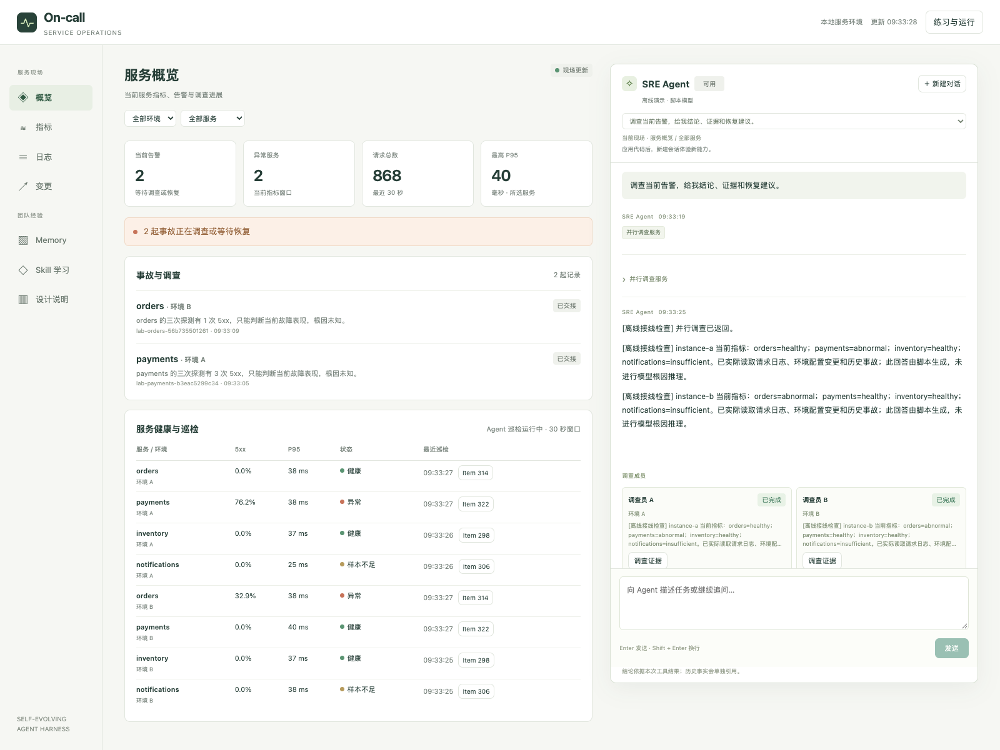

# Self-Evolving Agent Harness

让 On-call Agent 持续巡检、接手告警，并把事故经历转成经过评测的 Skill。包含运行系统、23 个独立实验和一个完整 Workshop。

## Run

需要 Git、Bash、make，以及 **uv 或 Python 3.12**。首次安装需要联网；演练不需要 API key。

```bash
git clone https://github.com/tylerelyt/self-evolving-agent-harness.git
cd self-evolving-agent-harness
make setup
make demo
```

这会运行两个真实 Hermes、两套 HTTP 环境与原生 SkillClaw：注入故障 → 调查 → 交接 → 恢复 → 演化 → 评测 → 发布 → 新任务采用 → 回退。模型响应和候选修订由固定脚本驱动，远程模型调用为 0；两轮恢复窗口需要等待数分钟。

末尾输出来自这次实际运行：

```text
paired replay: baseline 1/3 -> candidate 3/3
round 1: publish; round 2 adopted: True
instance-a: [503, 200]
instance-b: [503, 503]
rollback: completed
closed_loop_verified: True
evidence: .../report.json
```

## Change something

| 你要改什么 | 直接打开 |
| --- | --- |
| 巡检与故障调查的方法 | [On-call Skill](apps/oncall/patrol/skills/oncall-alert-triage/SKILL.md) |
| 告警、分支、通知、记忆与放行逻辑 | [六个函数的练习](workshop/capstone/lab/self_improvement_agent.py) · `make lab` |
| 发布与回退的完整执行链 | [workflow.py](apps/oncall/workflow.py) |
| 新旧版本为何通过或被拒绝 | [评测门槛](src/self_evolving_harness/evaluation.py) |

脚本模型只支持固定场景；任意自然语言规则修改使用在线模型验证。

`make ui` 打开完整系统工作台；`make check` 运行零模型回归。模型演示、在线模型和真实协议执行的区别及配置见[运行参考](workshop/capstone/RUNNING.md)。

[](workshop/capstone/README.md#启动本地工作台)

上图使用脚本模型。运行自己的工作台用 `make ui`。

## 逐讲练习

[01—23 实验目录与关键词](examples/README.md) · [Codex Notebook 环境](examples/CODEX.md) · [课程](https://time.geekbang.org/column/intro/101188801)

## 独立综合实战

[On-call Workshop](workshop/capstone/README.md)：从六个函数开始搭建，最后用同一份实现验证完整闭环。

## 运行系统

[持续部署与 OpenViking](deploy/README.md) · [系统结构](docs/architecture/README.md) · [参与开发](CONTRIBUTING.md)。长期服务与有界演练使用不同入口。

## 运行说明

[命令、在线模型与证据](workshop/capstone/RUNNING.md) · [平台条件](COURSE_MAP.md) · [MIT](LICENSE)
