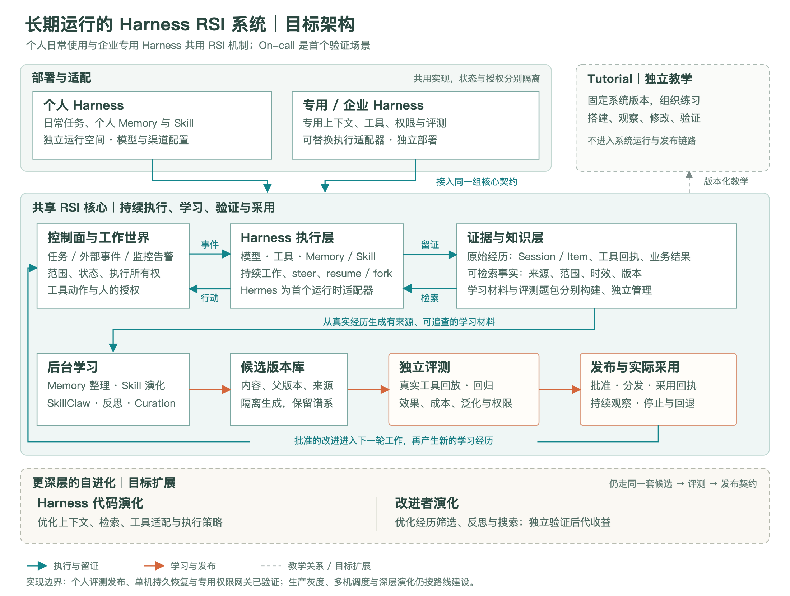

# Long-lived self-improving system

This directory defines the engineering direction of Self-Evolving Agent Harness: a maintained system that performs recurring work, learns from verified experience, evaluates changes, and adopts approved versions in subsequent work.

The system has its own architecture, interfaces, releases, and acceptance criteria. Tutorials teach selected capabilities of a pinned system version. A tutorial does not define the production architecture or certify production readiness.

It is intended for daily personal Harness use and dedicated workload/enterprise Harnesses. [Deployment profiles](../../deploy/README.md) provide single-host lifecycle and persistent workspaces; organization-specific context, tools, policy and evaluation belong to the dedicated adapter.

## Design documents

Personal and dedicated deployments use the same RSI contracts. Tutorials are a versioned teaching view; the lower dashed panel identifies deeper evolution targets. The figure describes the target architecture, not completion of every component. [Editable diagram source](../../assets/images/maintained-rsi-system.svg).

- [Target architecture](TARGET-ARCHITECTURE.md): responsibilities, execution and learning loops, state ownership, deployment, recovery, and operational requirements.
- [Shared contracts](CONTRACTS.md): the objects and invariants connecting execution, evidence, learning, evaluation, publication, and adoption.
- [Engineering roadmap](ROADMAP.md): evidence required at each milestone, including the current implementation boundary.
- [Implementation and verification](IMPLEMENTATION.md): extracted code, actual local checks and remaining integration work.
- [System/tutorial separation decision](../adr/0001-system-and-tutorials.md): dependency direction and migration rules.
- [Personal and dedicated deployment decision](../adr/0002-personal-and-dedicated-harness.md): the two uses of the same technical system.
- [Contribution workflow](../../CONTRIBUTING.md): changing the system and keeping teaching material aligned.

## Current implementation boundary

The maintained application, HTTP environment, workbench, Skills and integrations live in [`apps/oncall`](../../apps/oncall/README.md). The installable wheel includes these modules and static resources; runtime imports do not depend on `examples/` or `workshop/`. Existing teaching commands delegate to the same maintained source.

The shared core implements immutable Skill snapshots and complete bundles, paired evaluation gates, a candidate lifecycle ledger, durable job leases/checkpoints/retries, personal governed assignments, authenticated scoped approvals and action reconciliation. Continuous learning uses that core. The dedicated On-call deployment resumes the same workspace, native Sessions/Items and approved methods after restart.

The [personal learning path](../../deploy/PERSONAL-LEARNING.md) has actual DeepSeek/Hermes learning, independent tool evaluation, publication, new-task adoption and rollback evidence. The [enterprise boundary](../../apps/oncall/ENTERPRISE.md) executes recovery through an authenticated gateway with signed exact-scope approvals; organization-specific SSO and real service commands remain deployment inputs.

The complete controlled walkthrough is verified with a scripted model. Real-model On-call acceptance completed four incidents with both generated revisions correctly rejected; this is guarded operation, not a demonstrated On-call quality gain. Failures remain recorded independently, and a successful personal task does not certify another workload. Long-duration quality, multi-host scheduling, production canaries and autonomous Harness/improver evolution remain separate gates.

## Architecture ownership

This directory is the canonical home for system-level decisions. Tutorial-specific setup, learner changes, constructed faults, expected observations, and grading stay in [tutorials](../../tutorials/README.md) and the existing exercise directories.

A design can be proposed before its implementation is complete. Acceptance requires runnable behavior and linked evidence; documentation, diagrams, and screenshots alone do not satisfy a runtime milestone.
