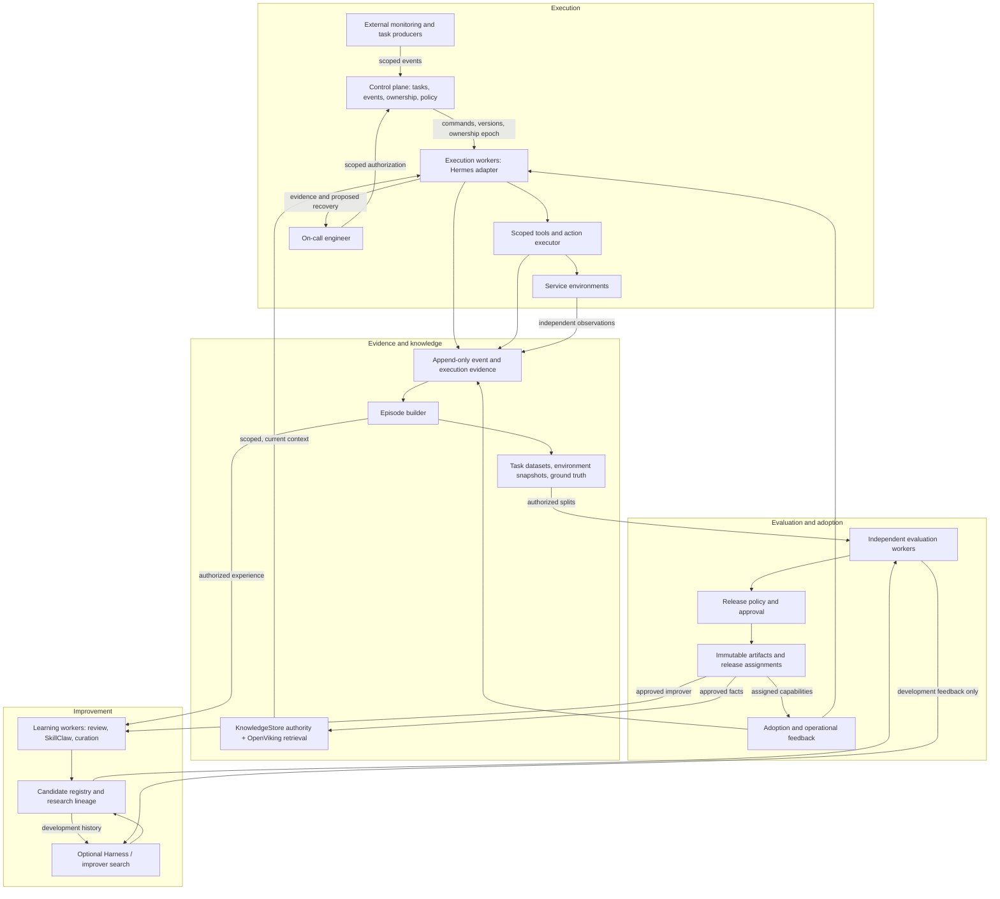
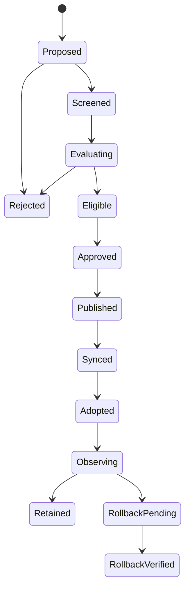

# Target architecture

Supported components are described in [implementation](IMPLEMENTATION.md); planned capabilities and acceptance conditions are listed in the [roadmap](ROADMAP.md).

## Purpose and system boundary

Self-Evolving Agent Harness is a long-lived system that performs scoped work, preserves execution evidence, learns reusable facts and methods, and deploys validated improvements into subsequent work. The initial workload is continuous service inspection and On-call investigation.

The deployment target includes a daily personal Harness and dedicated organization/workload Harnesses. Both retain a persistent execution and learning environment. A dedicated adapter can specialize execution, context, tools, authority and task evaluation while reusing the common RSI lifecycle. The [deployment runner](../../deploy/README.md) supports single-host operation; enterprise adapters supply organization-specific integrations.

The first learning target is Memory and Skill behavior with fixed model weights. Harness code and the method that generates improvements can become additional versioned targets later. Model training is not required for the initial system.

The system accepts goals and events, owns execution state, calls models and tools, and produces reports, authorized actions, evidence, and approved capability versions. External monitoring owns alert production. Business services own business state. Human engineers own the decisions that exceed preauthorized policy, including scoped recovery approval.

The continuous service runs until stopped. Controlled verification scenarios use bounded execution, isolated service worlds and explicit fault injection.

## Architecture overview



The loops share evidence and version identity. Execution stays available when learning fails. Learning may continue when a candidate is rejected. A failed adoption does not erase a successful evaluation; it prevents the release from being considered fully adopted.

## Responsibilities and state ownership

| Boundary | Owns | Does not own |
| --- | --- | --- |
| Control plane | Task state, event routing, execution ownership, policy references, command deduplication | Model reasoning or business truth |
| Execution worker | One active task attempt, model/tool loop, checkpoints, observed capability versions | Final release approval or unrestricted recovery |
| Evidence store | Original events, tool receipts, Session/Item references, action results and provenance | Treating model summaries as authoritative facts |
| Knowledge service | Scoped fact revisions, retrieval indexes, freshness and replacement relationships | The current business state without fresh observations |
| Learning worker | Experience selection, reflection, candidate creation and curation | Editing formal artifacts or final ground truth |
| Evaluation worker | Reproducible task environments, comparisons, independent observations and reports | Promoting its own results to production |
| Release controller | Approved artifact references, assignments, rollout/rollback state | Reversing completed business side effects |
| Workbench / client | Views, commands, approvals and evidence navigation | Authoritative task state |

Single-host deployment uses local control processes, SQLite, artifact files and separate workers. Multi-host deployment additionally requires distributed ownership and state coordination.

## Continuous execution and On-call handoff

Each inspection worker receives an authorized environment/service scope and recurring work policy. It loads the assigned inspection Skill, observes current service state, retrieves relevant history, and records structured results. A per-service index keeps the most recent Session and report Item for resume or fork.

An external alert carries an event identity, source, scope, observation time, and incident identity. The control plane authorizes and deduplicates it, finds the execution owner, and steers the relevant task. Receipt, routing, inclusion in actual model input, and handling are separate states.

The On-call Skill guides evidence collection and analysis. The worker can fork an investigation from a specific report Item, preserving the parent reference while obtaining fresh observations. The report separates observed facts, hypotheses, missing evidence, impact, and proposed recovery.

After paging the engineer, inspection continues. Waiting for approval belongs to the incident lifecycle rather than an indefinitely blocked inspection turn. Recovery requires an authorization bound to the incident, environment, action parameters, evidence, and validity period. Independent post-action observations determine recovery; a model's completion statement does not close the incident.

## Commands, ownership and interruption

A command contains a unique idempotency key, scope, target task, and expected task-state version. The server authorizes first, then deduplicates and checks conflicts. An accepted command is not yet a completed task.

At most one effective owner may commit events or actions for a task attempt. Local execution can enforce this with a process owner and writer lock. Distributed execution requires a lease, monotonically increasing ownership epoch, and fencing checks at state writes and the action executor.

Interrupt requests use a control path that does not wait behind the task's ordinary input queue. Request acceptance, cessation of new calls, task suspension, and task termination are separately observable. An interruption cannot undo an external action already sent.

On owner loss, a replacement reads the checkpoint and pending actions. It queries uncertain action outcomes before retrying. A lease prevents stale future commits; it does not retract a request already delivered to a business system. Where neither idempotency nor result reconciliation is available, the action remains unresolved and is handed to an engineer.

## Evidence and the knowledge lifecycle

Original evidence is append-only except for explicit retention/deletion operations. Derived summaries and retrieval indexes refer back to it. A storage location, Session ID, or guessed artifact path does not grant access.

An Episode groups related work and outcomes: initial inspection, alert response, investigation forks, human correction, authorized recovery, and independent outcome observations. It records what each stage knew at that time. Later evidence cannot silently become an input supposedly available during the initial decision.

Memory stores facts with provenance, scope, validity and supersession. Skills store reusable procedures with applicability and verification requirements. Incident-specific conclusions remain historical facts; they do not become universal diagnosis rules.

Sharing is explicit. A method can be shared across environments while endpoints and topology remain scoped parameters. Retrieval checks tenant/project/environment permissions, then freshness and relevance. An old memory helps locate evidence but does not replace current service observations.

Facts can be updated under preauthorized policy without a full Skill benchmark. Shared or high-impact changes require stronger verification. Each model request records the fact view it actually received, so dynamic knowledge remains auditable.

### Current external-memory implementation

The maintained On-call application implements this boundary with a local `KnowledgeStore` and an external OpenViking service. `KnowledgeStore` owns immutable source-linked fact revisions, exact tenant/environment/service scopes, compare-and-swap heads, TTL/revocation and the publication outbox. SQLite is the authority and retry journal; it is not a parallel retrieval backend. Original Session/Item evidence stays in its source store.

A separate memory worker verifies closed incidents, performs native Hermes fact review and queues approved historical facts and source-derived runbooks for publication. Runbook revisions retain the actual approved Skill tool-read content and are returned only when their digest matches the current assignment. Old revisions are retained for audit rather than rewritten into the new method. New fact/method evidence creates a CAS successor; expired/revoked or superseded documents cannot be revived by the remote index.

The OpenViking adapter checks successful native content/index publication and exact readback. Retrieval uses the pinned Hermes OpenViking provider's `viking_search` and `viking_read`, then checks scope, revision identity, current head, validity and citation hash. An outage is visible as unavailable memory; it cannot be converted into a SQLite cache hit. Patrol and investigation keep historical facts separate from fresh service measurements. The Memory UI exposes the same revision/publication/source chain.

The default dedicated deployment supervises real OpenViking 0.4.12 with persistent filesystem/index state, after `deploy/setup_openviking.py` installation. Its local character n-gram feature-hashing encoder provides lexical vectors while DeepSeek produces bounded indexing summaries; the default cumulative 60-request model budget survives restart. This is a functional deployment and retrieval integration, not proof of semantic retrieval quality, retained RSI gains or production multi-tenant access control. Enterprises can supply an external OpenViking endpoint and independently evaluated embedding/model configuration. See [OpenViking deployment](../../deploy/OPENVIKING.md).

## Durable learning

Foreground learning can save observations quickly. Durable learning jobs operate on bounded Episode snapshots, have stable identities and input watermarks, and record retries and generator versions. Losing a foreground process must not lose an already accepted learning job.

Learning workers write to isolated candidate workspaces. Approved Skill artifacts are read-only to execution and learning workers. Built-in self-improvement hooks must use candidate destinations or explicitly scoped local stores; they must not bypass formal publication by overwriting an active shared Skill.

SkillClaw is the initial collective-learning adapter. Its archive and model-facing traffic are authorized and traceable. Its content checks and text replay can screen candidates; business publication additionally requires independent environment/tool evaluation.

Curation produces ordinary candidates: merges, deprecations, reference moves and deletions all preserve source and parent relationships. The full Skill bundle includes executable scripts and references, not only `SKILL.md`.

## Independent evaluation

Evaluation has three scopes:

1. **Artifact validity:** structure, provenance, applicability, permissions, dependencies and content checks.
2. **Execution quality:** actual tool behavior, business results, regression, recovery correctness, cost and latency under controlled conditions.
3. **Improver quality:** the quality and transfer of descendants produced from matched initial capabilities, experience and budgets.

Each report binds the candidate and baseline artifact digests, task dataset, environment snapshot, ground truth, scorer, model configuration, repetition plan and budget. Missing or invalid cases remain visible and do not count as passes.

Experience, development, selection and final acceptance data have different visibility. Correlated records from the same incident or fault template remain grouped. A private score repeatedly exposed to an outer optimizer is a selection signal for that optimizer, not an untouched final test.

On-call evaluation runs in independent service environments with controlled notifications and recovery tools. Historical tool-output playback is useful for evidence inspection but cannot judge actions absent from the capture; it must report insufficient observations rather than inventing responses.

Semantic model review can supplement externally checked outcomes. A different judging model does not automatically establish independence; data access, protected ground truth and evidence determine the boundary. Scorer corrections are separately versioned and trigger re-evaluation of affected baselines and candidates.

## Publication, rollout and rollback

Research lineage may retain multiple valid exploratory branches. The formal release registry contains approved versions and their authorized assignments. A promising research branch does not gain production traffic merely by being archived.



Every transition has an idempotent operation and evidence reference. Publish immutable artifacts before atomically changing the formal reference. Assign versions by incident or other stable business unit; one investigation should not change methods halfway through ordinary rollout. Emergency authority revocation is independent and can apply immediately.

Start with explicit local assignments. Production canaries later add cohort definitions, minimum effective samples, observation windows, quality/cost limits, stop conditions and rollback targets. Thresholds are agreed before exposure; this design specifies no universal numerical defaults.

Adoption records show the worker, task/round, exact bundle, load result and relevant behavior. File synchronization is only one stage. Rollback controls future version selection and verifies fresh task behavior; it does not compensate completed notifications or business changes.

## Harness and improver evolution

Later experiments may change retrieval, context construction, experience selection, reflection, search policy, tool adapters or Harness code. Such changes use the same Candidate and EvaluationReport contracts, with stronger compatibility, recovery and permission checks.

A candidate improver is compared against the current one using matched execution starting points, experience pools, evaluation protocol and total budgets. Measure validated descendant gains, regressions, cost and transfer, not the number of generated files. Accepted improvers take effect at a learning-batch boundary.

Generation runs in an isolated workspace with bounded tools and credentials. The final acceptance environment, policy floor, deployment credentials and ground truth are outside its write authority. Changing evaluation or governance is a separate reviewed task with an independent baseline.

## Operability and maintenance

The operator needs a chain from event to task attempt, Session/Item, tool call, action, Episode, candidate, evaluation, release and adoption. Structured logs carry these identifiers and redact credentials. Raw evidence is permissioned separately from derived views.

Operational views cover queue age, owner health, stalled checkpoints, model/tool failures, pending actions, learning retries, evaluation validity, release/adoption lag, quality regressions and budgets. Inspection and alert handling have separate capacity from background learning. Budget exhaustion pauses or rejects optional work without manufacturing success.

Backups include authoritative task/action state, artifact manifests, fact revisions and evidence references. A restore drill must demonstrate consistent resumption and action reconciliation. Retention records deletion and invalidates affected indexes; learned artifacts derived from revoked evidence require review rather than disappearing silently.

System readiness combines three independent gates: functional correctness, real-model task quality, and operational resilience. A deterministic demonstration can satisfy functional gates without satisfying the other two.

## Proposed package and dependency structure

The following logical package layout describes planned module decomposition; current paths are listed in [implementation](IMPLEMENTATION.md):

```text
src/self_evolving_harness/
  contracts/       # validated objects and schema migrations
  control/         # tasks, events, ownership, policy references
  execution/       # task lifecycle and checkpoints
  evidence/        # raw receipts, Episodes and provenance
  knowledge/       # scoped facts and retrieval
  learning/        # durable jobs, candidates and curation
  evaluation/      # task environments, reports and gates
  releases/        # immutable artifacts, assignment and adoption
  adapters/        # Hermes, SkillClaw, model and storage integrations
apps/
  oncall/          # first maintained workload
  workbench/       # clients and evidence views
tests/
  contract/ integration/ recovery/ quality/
tutorials/         # pinned teaching paths and controlled exercises
examples/          # independently runnable concept exercises
```

Applications and exercise entrypoints depend on core contracts and adapters. Hermes and SkillClaw adapters use their pinned upstream runtime interfaces.

Compatibility entrypoints preserve existing callers and evidence formats. Module changes include behavioral and persistence checks.

## Engineering references

Related implementations and research:

- [Hermes background review](https://github.com/NousResearch/hermes-agent/blob/7f9033fbea75361a4844c788c737f40d63caf2af/agent/background_review.py): snapshot review, persistence separation and dispatch restrictions.
- [Letta context repositories](https://www.letta.com/blog/context-repositories/) and [Mods](https://docs.letta.com/configuration/mods): versioned context and an explicit runtime-extension boundary.
- [SkillClaw validation worker](https://github.com/AMAP-ML/SkillClaw/blob/334ddf82856826b7a259470c6670fb0ef5ce2dc4/skillclaw/validation_worker.py): a candidate-validation integration point whose text replay differs from business tool evaluation.
- [Anthropic skill-creator](https://github.com/anthropics/skills/tree/main/skills/skill-creator): skill iteration and comparative evaluation.
- [Darwin Gödel Machine](https://arxiv.org/abs/2505.22954): research archives and branching Agent evolution.
- [AIDE²](https://arxiv.org/abs/2609.26457): nested optimization with budgeted evaluation and separate improver tests.
- [HyperAgents](https://arxiv.org/abs/2603.19461): making task and improvement procedures editable and testing improvement ability.

Runtime dependency pins are recorded in `scripts/`; research references can describe different upstream revisions.
