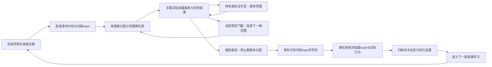
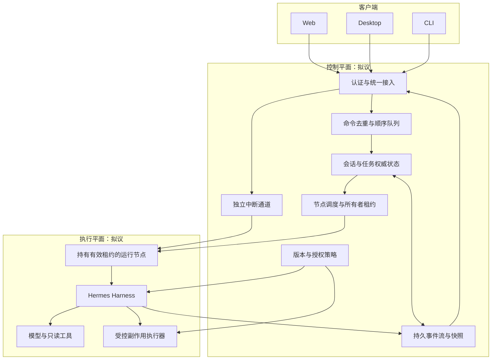
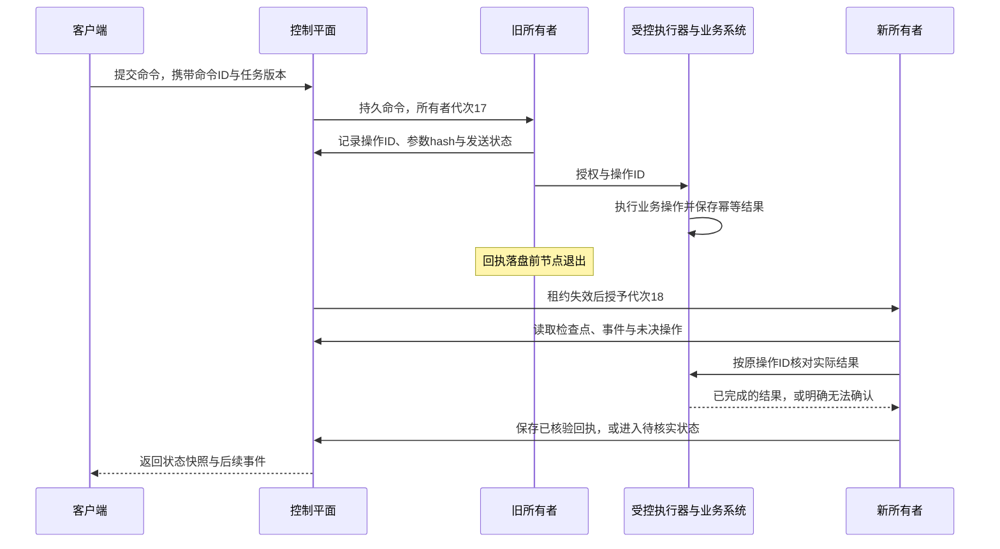

# 生产扩展设计与系统设计练习

长期系统架构与迭代计划统一维护在[系统设计目录](../../docs/architecture/README.md)。本文保留综合练习中的生产设计讨论与教学场景；长期系统的职责、契约和验收边界以该目录为准，本文中的拟议能力仍不代表已经实现。

本地双实例演练提供了检查一项方法变更的具体对象：候选来自哪些执行经历，新旧版本在相同现场怎样行动，批准内容是否进入后续任务，以及回退后的任务实际读取了哪个版本。进入生产后，还要决定这项变更先影响谁、观察多久、出现什么情况就停止，以及运行节点失效时由谁接续工作。

本文给出这些问题的设计方案和验收场景。灰度控制器、企业身份权限、跨机器调度和多客户端执行协议属于拟议的生产架构；本目录的本地工作台没有实现这些分布式平台能力。安装、运行与本地证据检查见[运行说明](README.md)。

## 先明确本地验证的边界

| 对象 | 本地演练的验证方式 | 生产部署需要补足的机制 |
| --- | --- | --- |
| 实例与环境 | 两个本机 Hermes 进程和相互独立的 HTTP 环境 | 节点注册、资源隔离、租约、故障重调度 |
| 事故处理 | 外部监控告警、同回合 steer、报告 Item 分支、工程师交接和恢复账本 | 接入真实告警系统；按租户、环境、服务确定所有者并处理重复投递 |
| 人工批准 | 本地工作台记录明确确认及绑定范围 | 经过认证的工程师身份、角色权限、授权期限和职责分离 |
| 方法变更 | 隔离候选、冻结回放、按 hash 发布、后续任务核验与本地回退验证 | 发布计划、灰度分配、最低有效样本、停止条件和持续质量监控 |
| 执行历史 | 本机文件、SQLite 与 Session/Item 引用 | 跨节点可访问的权威状态、持久事件、备份、保留和访问控制 |
| 模型结果 | 脚本模型可稳定复现；真实模型验收另记 | 明确模型及配置版本，在真实工作负载中验证质量、耗时和成本 |

表中的本地机制是否在某次运行中通过，仍须查看那一次运行的原始回执和审计结果。文档、按钮和同步文件的存在本身不构成运行验收。

## 一项 Skill 变更怎样获得生产流量

假设候选为首次 HTTP 5xx 增加了一次安全复核。离线比较已经确认：该复核能区分两种请求表现，也没有给首次成功的任务增加查询。接下来要检查它在实际任务中是否仍然有价值。流量分配应由 Harness 的发布控制器决定；Skill 内容不能自行扩大采用范围。

发布计划需要固定以下内容，再进入审批：

```yaml
release_id: triage-release-example
baseline_sha256: <已知可用版本的内容哈希>
candidate_sha256: <候选内容哈希>
sources_manifest_sha256: <来源Session与归档清单哈希>
evaluation:
  dataset_sha256: <冻结题包哈希>
  label_revision: <独立标注版本>
  result_manifest_sha256: <回放与评分证据哈希>
scope:
  tenant: <租户>
  environments: [<生产环境>]
  services: [<指定服务>]
assignment_unit: incident_id
initial_fraction: 0.05
observation_window: 24h
minimum_eligible_candidate_incidents: 100
minimum_per_major_incident_type: 20
maximum_concurrent_candidate_tasks: 2
limits: <探测次数、QPS、超时、任务时长与模型预算>
stop_conditions: <关键业务底线与运行健康阈值>
rollback_target_sha256: <批准的已知可用版本>
approved_by: <经过认证的发布批准者>
```

这里的 5%、24 小时、100 起事故、每类 20 起和并发 2 仅用于说明设计，没有作为仓库运行默认值，也不是统计充分性的证明。实际门槛应在发布前按事故分布、业务风险、标注能力和可接受成本确定。

分配单位选择事故，是因为初判与补查共享同一个现场。控制器根据租户、环境、服务、事故 ID 和发布 ID 作稳定分配，将分配决定、Skill hash 和发布计划 ID 写进任务记录。同一事故不会因为告警重投、客户端切换或新建补查 Session 而换版本；旧调查继续固定启动时的内容，新任务才读取新的分配决定。

控制组与候选组应来自同期、可比较的事故范围。按故障类型和服务分别检查结果，避免候选组恰好多了容易处理的任务。一次事故中的多次 HTTP 请求只增加取证，不增加独立事故样本数。

下面的状态转换关注决定依据：时间过去并不自动触发扩大范围，回退完成也需要新的执行证据。



## 观察运行健康，也观察工作质量

候选在处理任务，不代表它已经正确履职。监控需要把以下两组信息关联到同一个发布 ID、实际 Skill hash 和任务范围。

| 观察对象 | 应记录的量 | 它影响什么决定 |
| --- | --- | --- |
| 接入与执行健康 | Gateway 就绪状态、活跃会话、队列等待时间、模型与工具失败率、任务超时 | 限制新任务分配，区分平台故障和方法退步 |
| 初判质量 | 有独立证据支持的分类、关键事故遗漏、需要人工重做的调查 | 判断方法是否改善业务行为 |
| 人工交接 | 应交接事故中实际交接的比例、交接延迟、重复调查数 | 防止任务结束掩盖漏交接或重复工作 |
| 恢复判断 | 有效请求量、恢复窗口、错误请求和错误关闭记录 | 防止单次成功或低流量被当成恢复 |
| 开销 | 每任务探测次数、工具 QPS、任务耗时、模型用量与成本 | 判断收益是否超过新增服务压力与预算消耗 |
| 证据完整度 | 实际读取 hash、工具回执、报告 Item、评分有效性和批准引用 | 决定结果是否足以支持放量 |

运行指标可以自动采集，业务质量还需要适当的标注或独立复核。无法评分、缺失工具回执和范围不明的记录要分别保留。通过率只使用有效评分，同时展示有效数量、缺失数量和缺失原因；缺失过多时保持范围或暂停，不能用缩小后的分母制造发布依据。

例如，观察窗口结束时只得到 42 起有效候选事故，即使暂时没有错误，也没有达到上面示例的样本门槛，应保持原范围。另一个示例中，初判有所改善，但正常任务的探测次数与服务 QPS 超过计划上限，应暂停扩大范围并复核取舍。若出现越权操作、跨环境处置或达到预先定义的关键漏交接条件，则直接停止新版本分配，不等待平均得分变差。

本地恢复演练的两个独立 30 秒健康窗口，是服务恢复的检查条件。灰度观察窗口和有效事故样本是方法发布的检查条件，两者分别记录。生产恢复还应按服务 SLO 规定最低有效请求量；没有流量的窗口应明确标记为不足。

## 回退需要恢复方法，也需要检查后续任务

停止分配后，发布控制器从批准记录中读取回退目标，核对其完整内容和 hash，再通过正式分发通道同步。实例应上报接收结果，随后用新的任务核对实际 `skill_view` 回执与相应工具行为。文件已经恢复、清单已经更新、实例已经拉取、任务已经采用，应分别保留状态。

如果某个实例拉取失败，发布记录保持部分完成，控制器暂停向它分配需要该版本的新任务，并保留失败原因。直到该实例或替代实例留下有效的新任务证据，才能关闭回退验证。回退后的实际经历继续进入归档，成为下一批分析材料；后台学习保持隔离，不能立即把刚被撤回的候选再次推回正式入口。

已有调查继续固定原版本，保证报告可以追溯。发生严重权限或安全问题时，Harness 可以单独撤销工具授权、停止后续调用并交给工程师处理；这项控制独立于 Skill 文件。方法版本回退作用于工作方法，服务变更的恢复、已发生工具副作用的核对和 Memory 事实的维护由各自流程负责。

一次回退记录至少需要：触发指标及原始范围、停止时间、批准身份、原版本与目标 hash、每端同步回执、新任务 Session 与报告 Item、实际工具行为，以及尚未完成的实例。真实 HTTP 核查与冻结现场行为对照应标注各自来源，回放结果不冒充当前生产现场。

## Skill 发布与生产权限分别管理

职责分开以后，一项写操作才能被清楚解释。

| 执行者 | 所需权限 | 受控输出 |
| --- | --- | --- |
| 在线 On-call Agent | 在指定服务范围内读指标、日志和安全诊断接口 | 调查、建议、证据和交接请求 |
| 后台学习进程 | 读取获准的执行材料，写隔离候选 | 候选及来源、父版本和修改依据 |
| 独立评测 | 读取固定候选与题包，执行受限工具 | 可追溯回放、评分和版本建议 |
| 发布控制器与批准者 | 批准指定内容、范围和发布计划 | 正式版本、分配决定、停止与回退记录 |
| 生产执行器 | 按有效授权执行指定动作 | 幂等操作记录和真实执行回执 |

工程师批准处置时，应绑定事故、租户、环境、服务、具体参数、调查 Session/Item、证据 hash、操作 ID 和授权期限。执行前再次核对当前环境与授权；报告变化、参数变化、环境重建或授权过期，都应重新确认。发布 Skill 的权限与执行生产变更的权限分别授予。

本地工作台的明确确认可以验证这条交接链，但本地演练身份字段没有提供企业身份认证。生产接入需要认证主体、角色授权和完整审批审计。凭据由执行环境按权限提供；模型输入与可分享轨迹只保留必要引用，敏感工具输出在受控存储中保存并按访问范围展示。

会话、快照与归档的每次读写都核对租户和环境，Session ID 本身不充当访问凭证。传输与持久化采用相应的保护措施，并提前规定保留、删除与备份恢复的范围。模型可见的脱敏视图和受控原始回执分别保存，用引用与 hash 保持可追查性。日志、文档和工具返回按数据处理，不能借其中的指令改变任务授权或发布计划。

## 系统设计练习：三个客户端怎样继续同一项任务

设想工程师在 Web 发起调查，随后在 Desktop 查看进度，又从 CLI 发出暂停指令。三个入口应指向同一份任务状态和同一个执行所有者。下面是拟议架构，图中服务需要生产实现与独立验收。



对象关系应先固定：用户属于租户，可以拥有运行实例；实例管理会话，会话包含具体任务。Session 是上下文与历史的关联单位，Task 是一次有状态的执行，运行节点是当时承担执行的进程或机器。任务重新调度后可以保留任务与 Session 身份，同时改变执行节点和所有者代次。

普通指令写入持久命令队列，携带唯一命令 ID、目标任务和调用方看到的状态版本。服务端先授权，再去重并检查版本，由单个所有者依次消费。重复命令返回已有接收状态；两名工程师提交互相冲突的修改时，后到命令获得明确冲突结果，不能悄悄覆盖。

中断指令有独立控制通道，避免排在长任务消息后面。接收中断、停止新的模型或工具调用、以及任务实际终止分别记事件。已经发出的外部操作需要继续核对其结果，客户端不能把“中断请求已收到”显示成业务变更已经撤销。

客户端订阅持久事件并保存最后事件序号。重新连接时先获取对应状态快照，再读取快照之后的事件；遇到重复事件按事件 ID 去重。快照版本与事件游标必须来自同一条历史，避免界面显示新状态却漏掉中间工具回执。聊天文本是其中一种展示，任务状态仍由服务器维护。

## 节点失效时，先确认操作结果再接续

运行节点周期性续租。调度器只有在旧租约失效后才授予新所有者，并增加所有者代次。事件写入和受控执行器都核对代次，拒绝失去租约的旧进程继续提交状态或新操作。对于已经到达外部系统的请求，还需要外部幂等键或结果查询；单靠租约不能撤销已发生的副作用。

这个失败场景可以检查方案是否完整：旧节点已经发出一次批准的恢复请求，外部系统执行成功，但返回回执前节点退出。



新节点加载最近检查点，核对已经完成的工具调用，重建下一步工作。只读查询可以按任务时效重新读取，原回执仍保留；副作用操作先查操作账本和外部状态。若外部系统支持幂等键，可以使用同一个操作 ID 取得已有结果。若只能得到超时且无法确认是否执行，就进入待核实状态并交接工程师，不能为尽快恢复任务而盲目重复变更。

检查点至少保存任务状态、事件位置、固定 Skill hash、会话引用、未决命令与操作引用。它恢复的是执行依据；模型上下文恢复与真实任务恢复仍须分别验收。

## 调度、预算与可观测性怎样接入同一任务

调度根据节点健康、任务类型、可用工具、地域和资源选择执行位置，优先保留运行中会话的节点亲和性。迁移先持久化，再转移租约；不能同时启动两个都认为自己有写权的所有者。节点优雅退出时停止接新任务，结束或保存当前工作，再释放所有权。

并发、工具 QPS、模型预算和任务时限应按租户与任务分别限制。在线巡检与后台学习使用独立队列和资源预算，学习失败或耗尽预算不阻断正常巡检。模型和工具调用设置明确超时；重试依照操作是否可重复、已有回执和剩余预算决定。隔离与熔断发生后，任务留下可解释的等待或交接状态。

一次追查需要串起 `tenant_id → agent_instance_id → session_id → task_id → command_id`，工具调用还需要 `operation_id`，发布需要 `release_id + skill_sha256`，接续需要 `owner_epoch + event_seq`。这些引用共同关联告警、初判、分支、批准、执行、同步、采用和回退。监控除队列、节点与调用失败外，还应覆盖恢复成功率、重复执行、待核实操作、证据缺失和业务质量；任务显示完成不能替代这些检查。

## 怎样验收这份设计

下表是生产实现或系统设计答题的验收场景，当前仓库不声称已完成这些分布式测试。

| 场景 | 应观察到的行为与证据 |
| --- | --- |
| 灰度窗口到期但样本不足 | 保持范围，展示有效样本和缺口，不自动扩大 |
| 评分异常或关键回执缺失 | 单列不可判断项；不靠改变分母批准发布 |
| 方法质量上升但开销越界 | 按批准计划停止扩大，保留成本和调用证据 |
| 触及关键业务底线 | 停止新版本分配；完成批准回退与新任务采用验证 |
| 一个实例回退同步失败 | 保留部分完成状态，停止向该实例分配相关新任务 |
| Web 与 CLI 重复提交同一命令 | 只有一项已接收命令和一次预期操作，两个客户端看到同一结果 |
| 两名工程师并发修改同一任务 | 明确排序或冲突，无静默覆盖；批准范围可追溯 |
| 客户端断线后重连 | 从快照和游标连续恢复，无丢失回执或重复展示的业务操作 |
| 旧节点失联后重新上线 | 旧代次不能继续写入或发起新变更，新所有者可恢复任务 |
| 工具执行成功但回执丢失 | 按操作 ID 核对结果；不能确认时进入待核实状态 |
| 中断到达时工具尚未结束 | 先报告接收与取消进度，再呈现真实操作结果，不假称撤销 |
| 学习任务超时或预算耗尽 | 在线值守继续，候选保持隔离，失败记录可追查 |

设计交付应包含对象与状态、正常流程、上述失败流程、权限边界、数据保留与恢复依据，以及测量口径。完成实现后，再用原始请求、持久事件、工具回执与新任务行为逐项验收。生产能力的声明应跟随这些证据更新。
