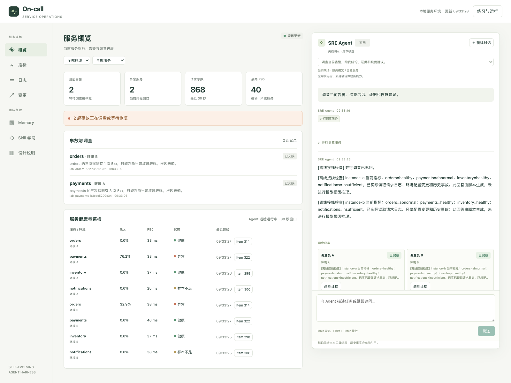

# 综合实战｜双实例 On-call Agent

两个 Hermes 持续巡检两套独立 HTTP 环境。外部监控发出告警后，Agent 初判、从报告 Item fork 补查，并向值班工程师交接。恢复经过批准和双健康窗口验证；初判会话进入 SkillClaw，候选经独立评测后发布，再由下一轮任务证明实际采用。

| 你想做什么 | 入口 | 运行方式 |
| --- | --- | --- |
| 自动复现完整两轮流程 | [双实例演练](#运行双实例演练) | 默认脚本模型，无需密钥，完成后退出 |
| 在业务页面操作完整系统 | [本地工作台](#启动本地工作台) | 加 `--solution`；持续运行，可选择脚本或真实模型 |
| 从代码逐步搭建系统 | [四步实作](lab/README.md) | 工作台默认加载练习文件 |
| 从终端持续值守 | [双实例持续值守](#双实例持续值守) | 手动注入故障，持续到 Ctrl-C |
| 接入外部记忆、数据集与优化器 | [进阶实验](#进阶实验) | 基础流程跑通后按需选择 |

完整入口是 [self_improvement_agent.py](self_improvement_agent.py)。每套环境包含订单、支付、库存和通知四个服务，演练以 A 的支付和 B 的订单为故障目标。第一轮分别注入持续与间歇失败，第二轮交换类型；冻结评测包含持续失败、间歇失败和首次成功未复现三个用例。



工作台实际运行截图，使用 `--solution --offline` 脚本模型模式。图中展示环境 A 的故障告警与两端并行调查结果；接入真实模型的方法见下文。

第一次接触这套系统，可以先看[完整演示导览](WALKTHROUGH.md)：从服务现场、告警调查到审批恢复、独立评测和下一轮采用，每一步都有实际运行截图和观察要点。

## 启动本地工作台

先在仓库根目录安装依赖：

```bash
bash scripts/setup_deps.sh
bash scripts/setup_skillclaw.sh
```

直接观察完整参考系统，可先用脚本模型启动：

```bash
.deps/hermes-agent/.venv/bin/python -B workshop/capstone/app.py \
  --solution --offline --state workshop/capstone/runtime/workbench --new-state --port 8765
```

`--new-state` 每次在指定路径旁创建独立工作目录，终端会打印实际的 `Workbench state`；退出后重新执行同一命令即可开始新演练，旧目录的会话、审批和证据保留。验收命令的 `--workbench` 使用这个实际目录。一次演练中修改练习代码，继续在当前工作台点击「应用代码」。

打开终端给出的地址，点击「启动 Agent」。先在「概览」「指标」「日志」「变更」看正常流量，再从「练习与运行」注入故障。调查交接后，在事故中「申请恢复」，核对范围与报告，再「批准并执行本地恢复」。两个独立健康窗口通过后，审批账本才关闭。Memory 和 Skill 学习页分别展示历史事实与方法版本。

「Memory」还提供「入口与 Memory 修订」：按按钮逐步观察旧入口、迁移、410→200 排查、原生后台 `memory replace` 和新会话采用。「Skill 学习」的「正式版本回退」先准备绑定版本的方案，明确批准后发布上一批准版本，并核对两端新会话、持续巡检与冻结现场行为对照。每一步的截图、动作和观察点见[完整演示导览](WALKTHROUGH.md)。

「设计说明」区分本次实际运行证据与生产灰度、权限、监控和分布式恢复要求；完整方案见[生产扩展设计与系统设计练习](PRODUCTION-DESIGN.md)。设计画面不表示本地演练已经接入企业认证或生产流量。

### 使用真实模型

```bash
cp -n workshop/capstone/.env.example .env
```

在仓库根目录 `.env` 中填写 `GLM_API_KEY`，按需设置 `GLM_MODEL` 和 `GLM_BASE_URL`，然后去掉启动命令中的 `--offline`。已有 `.env` 时只补齐字段，不要覆盖或提交本地配置。也可用 `--env-file /path/to/local.env` 指定其他配置文件；当前进程环境变量优先。

真实模型模式支持跨业务页的持续问答和并行只读调查。「新建对话」创建独立会话。脚本模式会明确标识接线演示，不提供自由模型推理。完整受控双轮已用脚本模型验收，真实模型目前完成部分联调。

### 逐步实现

去掉 `--solution`，工作台会加载 `lab/self_improvement_agent.py`；保留 `--new-state`，为练习分配独立目录。从仓库根目录打开 Coding Agent，让它先读 [lab/AGENTS.md](lab/AGENTS.md)，再按[四步实作指南](lab/README.md)逐项实现、检查并应用代码。

## 完整参考运行

自动演练与持续工作台共用巡检、调查和演化主链。[`service-patrol`](patrol/skills/service-patrol/SKILL.md) 控制例行巡检，[`oncall-alert-triage`](patrol/skills/oncall-alert-triage/SKILL.md) 控制告警初判与补查。

模块说明：[巡检与检查点](patrol/README.md) · [告警与调查](patrol/ONCALL.md) · [课程能力映射](INTEGRATION-PLAN.md)

## 运行双实例演练

### 准备并启动

在仓库根目录运行。需要 Git、Bash，以及 Python 3.12 或 `uv`。安装脚本会准备课程固定版本的 Hermes 和 SkillClaw。参考运行在 macOS 验证。

```bash
bash scripts/setup_deps.sh
bash scripts/setup_skillclaw.sh
.deps/hermes-agent/.venv/bin/python -B workshop/capstone/self_improvement_agent.py \
  --out workshop/capstone/runtime/fleet-demo
```

重跑时换一个尚不存在的 `--out` 目录。演练启动两个独立 HTTP 环境和两条持续巡检循环。A、B 各用一个进程和一套检查点。先等两端分别提交健康巡检记录，再注入支付持续失败和订单间歇失败。巡检只访问实验的本机回环地址。中断时会清理本次注入的故障，保留失败报告供检查。

### 跑完先看三份记录

终端最后会打印 `report.json` 的路径。以下文件都在这次的 `--out` 目录中。

1. 打开 `round-1/patrol-loop.json`，看两个 Agent 何时写下健康检查点，发出值班通知后何时恢复巡检。
2. 打开 `report.json`，看 `status` 是否为 `complete`，再读第一轮的 `decision`。若发布了候选，对照第二轮的 `adoption_verified`。
3. 回到 `round-2/collection/patrol-evidence.json`，选一个实例，对照它实际读取的 Skill 哈希和探测回执。由这条记录判断新一轮用到了什么。

演化或评测异常会在 `learning_errors` 中留下原因，本轮最终状态保留为 `learning_failed`。正式版本保留或恢复完成后，巡检继续运行，受控演练仍可收集下一轮事故证据。若部分发布后的恢复未完成，编排器停止追加故障并保留已有证据。完整成功审计会将这类运行判为未完成。

### 演练各阶段与完整证据

<details>
<summary>展开阶段说明与产物索引</summary>

实验环境模拟告警日志监控服务，注入故障后发出带事故 ID 的告警。Harness 收到告警后，通过 steer 将原始事件交给当前巡检回合。Hermes 读取获准的 `oncall-alert-triage` Skill，按它完成初判、补查和交接。初判落盘后，Hermes 从事故报告 Item fork，重新读取同一版 Skill，给出调查结论和恢复方案。方案及源 Session、报告 Item 写入实验内的工程师通知记录，并在终端显示通知。收到这份交接回执后，原巡检进程继续检查服务。每轮进入 SkillClaw 的是两个由 Client Proxy 归档的初判会话。

通知后的实验处置由状态机控制。脚本模拟值班工程师 `lab-oncall-approver` 的批准，每份批准绑定事故 ID、环境、服务和清除本地故障的动作。处置后，两边各取得两个互不重叠、5xx 为零的 30 秒窗口才关闭事故，再把恢复检查点关联回巡检库。两个进程贯穿两轮演练，等待恢复窗口约需两分钟。

每轮事故关闭后，编排器把已保存的探测与恢复证据交给隔离的 Hermes Background Review。复盘可以保留原状，也可以在自己的 Home 里提出历史事实。编排器逐字段核对来源与回执，再写入共享 SQLite。第二轮注入故障前，A 与 B 各开一个空会话接班，通过 `memory_lookup` 查询对方上一轮的事故，再用 `service_snapshot` 读取当前环境。历史事实提供当时发生了什么，当前状态由这一次 HTTP 指标决定。

随后，演练迁移 A 的支付诊断入口。修复会话从原生 Memory 读到旧入口，实际收到 410，再按回执验证新入口返回 200。隔离后台用原生 `memory replace` 修订这一条稳定事实。验收会比对旧文件、修订回读和新会话加载的哈希。新会话只有服务与环境范围，首次实际查询应命中新入口。诊断入口迁移与普通业务流量分开。

第一轮事故的分支报告和恢复回执也用于提炼独立的 `oncall-recovery-window-check`。原生后台把新方法写到候选 Home。Curator 在另一份候选库里归档构造的过时草稿，并保护正式初判 Skill。候选通过独立的恢复窗口用例后，才按内容哈希保存为获准版本。第二轮的新会话实际加载这一版，复核另一起事故的恢复证据。这个复核任务只读，事故关闭仍由审批和状态机决定。

演练收齐原生调查归档并确认恢复后，启动 Evolve Server。课程工程分析模板先核对真实补查分支，将有来源的改进方向加入实际候选修订请求；原生会话队列仍然只有两份初判。模板和脚本模型的作用均单独标明，不能将预设改进策略说成模型自主发现。候选进入隔离的验证队列。业务回放使用独立的固定快照，分别核对持续失败、间歇失败和首次探测未复现。新版本只有在通过全部用例、且至少修复一个旧版失败时，才按验收哈希发布到正式 SkillHub。A、B 各自拉取，然后交换故障类型，在新的调查会话中再次读取 Skill。第二轮须核对两端的探测顺序和结论。任一端未证明新版行为，就恢复上一个批准版本。两份验证通过的经历继续进入演化。第二轮产出的合格候选留待下一次现场任务验证。

默认使用本机脚本模型，无需 API key。Hermes 工具调用、HTTP 流量、SkillClaw 原生归档、演化与 SkillHub 同步实际运行。可选的 `--live` 使用已配置的 `GLM_API_KEY`、`GLM_MODEL` 与 `GLM_BASE_URL`，会产生模型请求。受控两轮的完整验收使用脚本模型；真实模型目前完成工作台前台、问答与 Memory 的部分联调，完整两轮尚未验收。

验收时挑一条第二轮调查，从 `patrol-evidence.json` 核对初判读到的 Skill 哈希与两个 HTTP 探测回执，再回查第一轮的采用决定和逐题证据。沿同一事故的 `investigation.json` 检查父 Session、原报告 Item 和分支里的三次探测，然后核对审批引用、处置回执及两个恢复窗口。想亲手巡检、控制故障开关并开展分支调查，可先做[单实例巡检](patrol/LAB.md)与[故障注入和调查](patrol/ONCALL.md)。

| 文件 | 查看什么 |
| --- | --- |
| `report.json` | 每轮起始和采用后的 Skill 哈希、演化决定、两端采用验证和恢复记录 |
| `round-*/collection/patrol-evidence.json` | 两端的事故、Skill 实际读取、初判探测和各实例的 `investigation` 记录 |
| `round-*/collection/<实例>/alert.json` | 监控替身发出的原始告警，含事故 ID、服务、环境和发送时间 |
| `round-*/collection/<实例>/investigation.json` | 长调查的父 Session、报告 Item、分支 Session、三次新探测和报告，也是本轮处置依据 |
| `round-*/collection/<实例>/page.json` | 本地 paging 回执，含事故范围、调查结论、恢复方案和分支报告 Item |
| `round-*/patrol-loop.json` | 注入前的健康检查点、通知后恢复的检查点、关闭后关联回巡检库的恢复检查点 |
| `round-*/incident-lifecycle.json` | 事故范围、批准与实际故障开关回执、两个恢复窗口和关闭记录 |
| `round-*/fact-review/<实例>/proposal.json` | 隔离复盘的候选事实、来源证据哈希和本地写入结果 |
| `shared-facts.sqlite3` | 已逐项核对、带来源 Session 和 Item 的历史事实 |
| `round-2/fact-handoff/<实例>/handoff.json` | 接班会话实际检索的历史记录和独立取得的当前 HTTP 指标 |
| `round-2/route-migration/sequence.json` | 旧入口可用的基线、迁移后的两次 HTTP 回执、原生替换和新会话首次查询 |
| `round-1/recovery-skill/sequence.json` | 事故回执、新 Skill 候选、Curator 归档与保护记录、独立评测和获准哈希 |
| `round-2/recovery-skill/adopt/result.json` | 新会话实际读取获准 Skill 后对另一事故的恢复复核 |
| `round-*/engineering-analysis.json` | 工程分析策略、原初判与真实补查回执、分析内容及其哈希 |
| `round-*/staging/queue-inputs.json` | 原生队列消费前的清单，核对只有两份初判，无补查分支 |
| `round-*/staging/execution-request-*.json` | 候选修订时实际发送的消息、参数与工程分析哈希 |
| `round-*/staging/evolution.json` | 演化使用的两份原生会话、候选父版本与候选哈希 |
| `round-*/evaluation/evaluation.json` | 有候选时生成，含新旧版本的逐题工具证据和门槛决定 |
| `round-*/recovery.json` | 两端关闭事故时的最终恢复窗口 |
| `http-workset.json` | 完成演练后生成的 HTTP 工作样本，每起事故一条 |

</details>

## 双实例持续值守

从仓库根目录运行。这个入口自行启动两套 HTTP 环境、两个 Hermes 巡检进程和各自的 SkillClaw Client Proxy。先完成上面的依赖安装，再选择一个新的 `--out` 目录。

```bash
PY=.deps/hermes-agent/.venv/bin/python
RUN=workshop/capstone/runtime/oncall-service
"$PY" -B workshop/capstone/self_improvement_agent.py --out "$RUN" --serve
```

保持这个终端运行。两个实例各自轮巡独立环境里的订单、支付、库存和通知四个服务。下面用 A 的支付服务和 B 的订单服务作为故障目标。等待两端各自留下健康检查点，再从另一个终端向环境注入故障。注入程序修改本地环境的故障状态，环境监控观察请求失败并发出带事故 ID 的告警，Harness 将原始告警交给 Hermes。两个实例各自调查、从初判报告 fork 补查、page 值班工程师，然后继续巡检。

用只读状态命令核对首次健康巡检。`services.payments.checkpoint` 应有 Session 和报告 Item，`matches_environment` 应为 `true`。把两处 `instance-a` 换成 `instance-b`，可以同样检查订单实例。

```bash
PY=.deps/hermes-agent/.venv/bin/python
RUN=workshop/capstone/runtime/oncall-service
"$PY" -B workshop/capstone/patrol/patrol.py \
  --state "$RUN/patrols/instance-a" status \
  --environment-state "$RUN/environments/instance-a"
```

```bash
PY=.deps/hermes-agent/.venv/bin/python
RUN=workshop/capstone/runtime/oncall-service
ENV_SCRIPT=workshop/capstone/patrol/environment.py

"$PY" -B "$ENV_SCRIPT" --state "$RUN/environments/instance-a" fault payments on
"$PY" -B "$ENV_SCRIPT" --state "$RUN/environments/instance-b" fault orders intermittent
```

两起故障可以分别注入、分别处理。重新运行状态命令，从目标服务的 `last_incident.page_receipt` 找到 paging 记录。同目录的 `investigation.json` 是调查分支及恢复建议。对照 paging 时间和之后的巡检检查点，确认交接后巡检仍在推进，再关闭该环境的故障。下面是纯 CLI 持续模式中由运行者手动清除实验故障的命令；工作台使用前述申请与批准流程。

```bash
"$PY" -B "$ENV_SCRIPT" --state "$RUN/environments/instance-a" fault payments off
"$PY" -B "$ENV_SCRIPT" --state "$RUN/environments/instance-b" fault orders off
```

巡检会继续核对恢复窗口。后台从已经恢复的事故中选取归档，按批次运行 SkillClaw 演化和独立回放。候选经过评测后才允许发布，后续新事故用实际加载的哈希和工具行为验证采用。没有新事故时，报告保留尚待采用验证的状态。候选保留、拒绝或学习异常都应从对应记录核对。

| 持续模式记录 | 查看什么 |
| --- | --- |
| `service.json` | 环境与巡检进程、学习进程及服务状态 |
| `patrols/<实例>/patrol.sqlite` | 巡检检查点、事故与恢复记录 |
| `patrols/<实例>/pages/<事故 ID>/page.json` | 发给值班工程师的通知、调查结论和恢复建议 |
| `patrols/<实例>/pages/<事故 ID>/investigation.json` | 源 Session、报告 Item、调查分支和新增探测 |
| `learning/state.json` | 当前正式哈希、最近一批的结果、发布后是否等待采用验证 |
| `learning/batches/<批次>/attempt-<次数>/result.json` | 两份来源会话、演化结果、独立评测和发布决定 |

学习批次要求两个实例都有已恢复、已归档且使用同一版正式 Skill 的事故。只完成一个实例的事故时，前台继续巡检，后台等待另一份合格经历。`last_release.status` 为 `awaiting_adoption` 表示已经发布，后续两端的新事故仍需证明采用；确认两端行为后才成为 `adopted`，触发恢复时记为 `rolled_back`。

要检验新版，等当前故障恢复、发布记录就绪后，再向任一责任服务注入新故障。可以交换持续失败和间歇失败，让两个实例面对不同于上一批次的现场。按 Ctrl-C 停止服务，已有记录保留在本次 `--out` 目录中。持续模式的后台学习需要恢复事故形成批次，是否发布以及是否完成采用验证由实际记录决定。

真实模型运行使用同一入口，加 `--live` 并设置 `GLM_API_KEY`。可选的 `GLM_MODEL` 和 `GLM_BASE_URL` 控制模型与端点。首次核对接线可以先运行默认脚本模型。旧的 `patrol/fleet.py` 入口继续接受原参数，默认委托同一个完整实现。

持续模式覆盖核心值守与后台学习。Memory 迁移与受控回退也可直接在工作台分步操作。恢复复核 Skill 和外部服务接入另有受控演练入口；GEPA、OpenViking、Langfuse 是否启用及通过，以本次运行的原始回执为准，不能从本地工作台截图推断已经完成远端接入。`--serve` 与 `--gepa`、`--enterprise`、`--langfuse`、`--openviking`、`--rehearse-rollback` 分别运行，CLI 会拒绝将持续模式与这些受控演练参数混用。

## 进阶实验

以下接入按需选择，不是启动基础系统的前置条件。

### 用 OpenViking 做跨实例交班

先按第 14 讲启动原生 OpenViking 服务。在运行参考实现的终端设置 `OPENVIKING_ENDPOINT`，指向服务的回环根地址，并设置同一授权范围的 `OPENVIKING_ACCOUNT` 和 `OPENVIKING_USER`。启用鉴权的服务还需设置 `OPENVIKING_API_KEY`。资料索引与检索会用到服务配置的模型。[第 14 讲服务启动](../../examples/14-external-memory-provider/OPENVIKING.md#运行原生-openviking)

```bash
.deps/hermes-agent/.venv/bin/python -B workshop/capstone/self_improvement_agent.py \
  --out workshop/capstone/runtime/fleet-openviking --openviking
```

每次演练使用独立资源目录。编排器先发布支付和订单的交班 runbook，再把通过背景复盘核对的事故事实写入对应目录。第二轮的 A、B 使用各自的身份和新 Hermes Home，通过 `memory_lookup` 按需触发原生 OpenViking 搜索和读取。初始提示只给事故范围。旧探测与来源 Item 帮助接班，当前状态由本次 `service_snapshot` 判断。

在总 `report.json` 查 runbook 与已发布事实的 URI，再对照 `round-2/fact-handoff/<实例>/handoff.json`。核对接班人读到对侧实例的来源、报告 Item、资料 URI 和独立 HTTP 快照。复盘决定保留原状时，交班仍可查 runbook 并获取当前读数。

配好后面各节的依赖和服务后，可以在同一次演练中使用 `--openviking --enterprise --gepa --langfuse`。总报告分别链接交班、根因评测和 GEPA 对照，Langfuse Trace 用下文的独立命令取回核对。

### 把巡检事故做成根因评测题

完成前面的依赖安装后，用新目录运行。

```bash
.deps/hermes-agent/.venv/bin/python -B workshop/capstone/self_improvement_agent.py \
  --out workshop/capstone/runtime/fleet-enterprise --enterprise
```

A 的支付服务通过实际 HTTP 请求调用库存，B 的订单服务调用通知。每个 Hermes 巡检自己的责任服务。对侧集群的同名服务有一处独立故障，用来检验调查会不会把两个事故混在一起。初判触发 steer，长调查从报告 Item fork，随后按演练审批清除目标故障。

故障计划在巡检前写入，指标、日志和调用链在处置前保存。题包将告警和探测绑定到源 Session 与 Item。独立标注还要核对审批、两个恢复窗口和对侧故障仍在的回执。第一轮事故用于开发评测，第二轮新事故用于最终留出。

打开 `enterprise/prepared/pack.json` 查看快照、独立标注和待补材料。再看 `enterprise/evaluation/report.json`，逐题核对新 Hermes 会话实际查询的证据和引用。调查模型收到题面、快照查询工具和指定 Skill，评分在外部用第 19 讲原有的证据评分器完成。企业题回放与 SkillClaw 的初判发布验收分别记录。

对照中只为候选增加一条规则，要求排除同名服务前查询并引用对侧告警和日志。候选先通过开发集，再原样进入留出集。本机脚本模型的两组参考结果均为 0/2 到 2/2。核对一条基线失败，看看它是否查到了本集群的根因，却漏查对侧证据。

已有题包时，可以直接重跑调查。

```bash
.deps/hermes-agent/.venv/bin/python -B workshop/capstone/patrol/enterprise_replay.py \
  --pack workshop/capstone/runtime/fleet-enterprise/enterprise/prepared/pack.json \
  --out workshop/capstone/runtime/enterprise-replay
```

本机脚本模型用于复跑这条链路。真实模型实验可显式加 `--live`。[第 19 讲配套操作](../../examples/19-enterprise-dataset/ARTICLE_GUIDE.md)

### 同集群也会有两个独立事故

同一次 `--enterprise` 演练还生成 `enterprise/case-boundaries/pack.json`。它为每个原事故派生两道题，两道题始终跟随同一个事故分组。先看开发集，再用第二轮事故检查同一份 Skill。

- **同集群并发故障**。在目标修复前后，对同集群的另一服务各做一次真实 HTTP 探测，两次都是 503。目标已通过两个健康窗口，另一服务仍故障。回放中要实际查到另一工单的告警和日志，再把它排除。即使两条记录都已查到，把它们引用为目标事故的证据仍会判错。
- **证据不足**。用同一事故的告警、指标和拓扑，明确把调用链和日志排除在快照覆盖范围外。Hermes 要在指定时间和服务范围内实际查到 `not_covered`，保留已知影响，把 `root_cause` 填成 `null`，列出待补查的调用链和上游日志。

在 `enterprise/round-*/same-cluster-distractors.json` 查看目标恢复前后的 HTTP 回执，在 `enterprise/case-boundaries/evaluation/report.json` 找到各题的新 Session 与评分。题包和评分规则单独锁定版本；第 19 讲题包、回放及 Langfuse 往返仍走原有入口。工具或 SessionDB 证据无法核验时，该题保留为未评分。

```bash
.deps/hermes-agent/.venv/bin/python -B workshop/capstone/patrol/enterprise_cases.py \
  --pack workshop/capstone/runtime/fleet-enterprise/enterprise/case-boundaries/pack.json \
  --out workshop/capstone/runtime/enterprise-boundaries-replay
```

### 一个根故障影响两个下游

启动两个独立的实验环境，分别生成开发题和留出题。支付和订单都通过真实 HTTP 调用通知服务，库存是同集群的健康对照。一次通知服务故障会使两条链路分别返回 503。逐条核对下游 span 与上游错误日志，它们指向同一根服务，但各自的 trace ID 不同。

```bash
RUN=workshop/capstone/runtime/fanout
.deps/hermes-agent/.venv/bin/python -B workshop/capstone/patrol/fanout.py --out "$RUN"
.deps/hermes-agent/.venv/bin/python -B workshop/capstone/patrol/fanout.py --audit "$RUN"
```

独立的实验审批只清除通知服务的一个故障标记。根服务、两个下游和库存都要经过两个互不重叠的健康窗口。恢复后的下游探测仍经过同一个上游。`captures/dev/capture.json`、`captures/holdout/capture.json` 和同目录的 `incident-lifecycle.json` 保留完整回执。

两版 Skill 在同一份开发题上比较。候选只增加一条规则，要求逐服务核对链路、确认共同根因并检查健康对照。报告即使写对了两个服务，也要取得各自的精确查询回执才能通过。开发集有合格版本时，才锁定该版本并在独立留出题上用新 Hermes Session 回放。在 `report.json` 核对结果和 Skill 哈希，再按其中的路径回查工具 Item。本机脚本模型用于验证接线和评分，可显式加 `--live` 评估模型的实际调查表现。

### 把巡检与分支记录接入 Langfuse

在自己的教学项目中设置 `LANGFUSE_PUBLIC_KEY`、`LANGFUSE_SECRET_KEY` 和 `LANGFUSE_BASE_URL`。用第 19 讲的安装入口准备隔离 SDK。在仓库根目录运行下面的命令。[自部署方式](../../examples/19-enterprise-dataset/selfhost/README.md)

```bash
PY=.deps/hermes-agent/.venv/bin/python
LF=examples/19-enterprise-dataset/.deps/sdk/bin/python
RUN=workshop/capstone/runtime/fleet-langfuse
"$PY" -B examples/19-enterprise-dataset/setup.py --langfuse
"$PY" -B workshop/capstone/self_improvement_agent.py \
  --out "$RUN" --enterprise --langfuse
```

`--langfuse` 在这次演练的巡检与长调查进程中启用 Hermes 原生插件，将模型和工具记录发到所配项目。默认仍由本机脚本模型驱动。两轮共采集四次巡检和四次从报告 Item fork 的调查。总报告先记为 `awaiting_remote_verification`，随后从项目取回记录核验。

```bash
"$LF" -B workshop/capstone/patrol/enterprise_langfuse.py \
  --run "$RUN" --dataset capstone-oncall-v1 \
  --out workshop/capstone/runtime/langfuse-verified --apply
```

输出目录须为新目录。`--dataset` 提供数据集名前缀，程序为每次发布分配唯一后缀，实际名称记在报告里。`--apply` 允许写入数据集。程序先对照 SessionDB 核对原生 Trace，再关联原事故的冻结快照与独立标注，最后按数据集时间点取回，核对题面、证据和来源。

只核对采集时，传 `--run` 和 `--out` 即可。从 `trace-index.json` 查每个 Trace 的事故、Session、报告 Item 和工具核对结果。发布与回取通过后，把输出中的 `restored/pack.json` 交给同一个 `enterprise_replay.py` 重新调查。

### 用 GEPA 做一轮离线对照

第 20 讲用工具回执和评分解释来搜索 Skill 正文。这里用双实例演练第一轮的种子 `oncall-alert-triage` 做同样的实验。GEPA 与 SkillClaw 从完全相同的 Skill 文件开始，分别从冻结回放题和现场归档学习。

完成上面的依赖安装后，在仓库根目录把第 20 讲固定的 GEPA 版本装进同一个 Hermes 环境，再用新目录运行。

```bash
PY=.deps/hermes-agent/.venv/bin/python
REQ=examples/20-gepa-offline-optimization/requirements.txt
if command -v uv >/dev/null 2>&1; then
  uv pip install --python "$PY" -r "$REQ"
else
  "$PY" -m pip --version >/dev/null 2>&1 || "$PY" -m ensurepip --upgrade
  "$PY" -m pip install -r "$REQ"
fi

"$PY" -B workshop/capstone/self_improvement_agent.py \
  --out workshop/capstone/runtime/fleet-gepa --gepa
```

默认由本机脚本模型驱动 Hermes 回放，GEPA 使用教学用的确定性反思规则，官方优化器实际执行搜索。使用 `--gepa --live` 时，显式设置 `GLM_API_KEY`、`GLM_MODEL`、`GLM_BASE_URL`。Hermes 回放和 GEPA 的官方反思提案都使用该端点。反思最多请求一次，输入只包含训练题反馈，原始响应单独保存。真实模型运行可能产生费用。

训练题提供反思材料，验证题决定是否选出候选。验证有提升时，系统固定候选哈希，再把种子和候选分别放到两组独立题上成对回放。第一组使用 SkillClaw 的发布验收题，第二组是最终留出题。验证无提升时，报告记为 `no_validation_gain`，两组评测都不打开。现场采集的 `working_only` 只用于回放复盘，四组题均来自单独冻结的快照。

本机脚本模型的参考结果是验证集从 0/2 到 2/2，发布验收和最终留出各从 1/3 到 3/3。搜索最多执行 8 个 Hermes 会话和 1 次反思提案。选出候选后的两组成对评测各执行 6 个会话。

先在 `round-1/gepa/report.json` 核对题目划分、搜索预算、验证得分和候选哈希。若有候选，再去 `round-1/gepa/release/evaluation.json` 与 `round-1/gepa/holdout/evaluation.json` 比较逐题结果。挑一题首次返回 5xx 的回放，核对新旧版本实际读取的 Skill、探测次数和结论。GEPA 结果用于离线对照，正式版本和第二轮采用由同轮 SkillClaw 的发布流程决定，可在总 `report.json` 中核对两端实际读取的哈希。

### 回退后用新巡检验证实际加载

用新的运行目录开启回退演练。

```bash
.deps/hermes-agent/.venv/bin/python -B workshop/capstone/self_improvement_agent.py \
  --out workshop/capstone/runtime/fleet-rollback --rehearse-rollback
```

第一轮候选通过验收并发布、第二轮的两个新任务都证明实际采用后，编排器在同一正式 SkillHub 恢复获准的前一版。两端同步后，给各自的责任服务重新注入持续故障，各开启一个新 Hermes Session。课堂脚本模型应读到种子哈希，记录一次实际 503，并报告 `failure_observed`。与第二轮同样首次收到 503 时的两次探测相比，回退后恢复了单次探测。

总 `report.json` 的 `rollback` 记录正式发布回执，`rollback_rehearsal.patrol_evidence` 指向两个新巡检。演练结束会清理这次注入的本地故障。回退巡检的会话归档用于验收，演化与企业题包继续使用主流程的两轮事故。没有形成可回退的正式发布时，验收会保留待验证项。

## 证据检查与回放

### 核对同一次演练的证据

用已完成的演练目录运行只读验收，JSON 报告输出到终端。

```bash
.deps/hermes-agent/.venv/bin/python -B workshop/capstone/patrol/audit_run.py \
  --run workshop/capstone/runtime/fleet-demo
```

验收回查 SessionDB 和工作样本，核对 SkillClaw 的候选、发布哈希与下一轮实际采用。启用 OpenViking、GEPA 或企业题包时，报告会分别核对该模块。Langfuse 取回目录可通过 `--langfuse` 加入，用恢复题包运行过独立回放时也可传入该回放目录 `--replay`。验收要求这些材料能追溯到同一轮演练。

可用 `--fanout workshop/capstone/runtime/fanout` 把独立的共享上游练习加入同一份验收报告。它有自己的故障、审批、恢复和回放记录。

`passed` 表示对应的证据通过核对，`pending` 表示仍缺少所需证据，`not_requested` 表示这次演练未启用该模块。默认退出码为 0 表示所提供的证据通过核对，报告仍可能列出待验证项。证据损坏、错配或演练未完成时，退出码为 1。

自动化验收时，可重复传入 `--require` 指定必须通过的检查。持续巡检使用 `--require core.continuous_patrol`，回退演练使用 `--require core.rollback`。指定的检查缺失、待验证或未启用时，JSON 仍会输出，命令以退出码 2 结束。

### 回放一次已完成的事故初判

打开运行目录的 `http-workset.json`，选一条 `cases` 记录。用这条记录的 `incident_id` 和 `skill_sha256` 替换下面的示例值，使用当时读到的 Skill 复跑。`--out` 使用新目录。

```bash
PY=.deps/hermes-agent/.venv/bin/python
RUN=workshop/capstone/runtime/fleet-demo
INCIDENT_ID='填入 incident_id'
SKILL_SHA='填入 skill_sha256'

"$PY" -B workshop/capstone/patrol/replay_workset.py \
  --workset "$RUN/http-workset.json" --incident-id "$INCIDENT_ID" \
  --skill "$RUN/formal/versions/$SKILL_SHA/oncall-alert-triage/SKILL.md" \
  --out "$RUN/replay-$INCIDENT_ID"
```

回放在独立 SessionDB 中实际运行 Hermes，默认由本机脚本模型驱动。需要使用配置好的 GLM 时，显式传入 `--live`。工具依次重放这起事故初判采集到的 HTTP 状态。分支探测、恢复窗口以及源 Session 和 Item 随同一事故保存，供追查依据。若新 Skill 要求更多探测，回放返回 `insufficient_capture`。这个结果用来定位缺哪一条取证，发布仍由前面的独立固定评测决定。

已有的完整演练若包含分支调查报告和两个恢复窗口，也可以单独导出。`--out` 须指定新文件，随后将回放的 `--workset` 指向该文件。

```bash
"$PY" -B workshop/capstone/patrol/export_workset.py \
  --run "$RUN" --out "$RUN/http-workset-copy.json"
```

HTTP 样本标为 `working_only`。跨服务根因评测可用上面的企业题入口，Langfuse 原生采集和 OpenViking 在[总装方案](INTEGRATION-PLAN.md)中另列接线。也可以做[值班学习与回退实作](LEARNING-LAB.md)，在固定事故快照上单独观察版本决定。 [支付查询短练习](../practice/README.md)
