# 跟着现场走一遍：自进化 On-call Workshop

你接手的是一个已经有流量的服务现场。两套环境各有四个 HTTP 服务，指标、请求日志和变更记录已经就绪。接下来，让 Hermes 接上巡检，处理外部告警，向值班工程师交接，再把这次经历变成下一轮能用上的方法。

这份导览展示完整参考系统的一次实际运行。截图使用 `--solution --offline`：HTTP 服务、Hermes 会话、工具调用、SkillClaw 与评测发布程序实际运行，模型响应由本地脚本提供。对话里会显示「离线接线检查」，因此这些图证明流程与组件交接，不证明在线模型的推理或学习质量。

先按 [启动说明](README.md#启动本地工作台) 打开工作台。想亲手接入各项能力时，使用[四步实作](lab/README.md)，每完成一步再回到相同的业务现场观察。这里先带你看清系统完整运行时，各个环节应该如何衔接。

实作时，你始终在同一份 `lab/self_improvement_agent.py` 中接入能力。学习者负责提出目标、核对证据和批准动作，Coding Agent 负责实现与检查。四次改动对应下面这些可观察的变化：

| 接入目标 | 回到工作台验证 | 对应导览 |
| --- | --- | --- |
| 让 Agent 上线 | 两套环境持续出现巡检记录 | 1—2 |
| 让它接手告警 | 调查、交接、审批恢复后继续巡检 | 3—5 |
| 让新任务用上历史 | 新会话召回旧事故并重新取数 | 6 |
| 让团队改进方法 | 候选通过评测发布，下一轮实际采用 | 7—8 |

导览涵盖以下运行环节，并区分实际执行证据与生产设计。

| 运行环节 | 在导览中看什么 | 证据类型 |
| --- | --- | --- |
| 持续值守与任务接管 | 1—4：双实例巡检、外部告警、初判、报告 Item fork 与交接 | 本地原生执行 |
| 人工处置与恢复 | 5：明确批准、两个独立健康窗口、继续巡检 | 本地 HTTP 与审批账本 |
| 业务变化后的 Memory | 6：历史召回、入口迁移、410→200、原生 replace、新会话采用 | 本地原生执行 |
| 方法改进与多实例共享 | 7：两端初判来源、SkillClaw 候选和父版本 | 原生归档与演化 |
| 独立业务评测 | 7：冻结三题、新旧回放、1/3→3/3 和不可评分数量 | 冻结现场原生回放 |
| 方法进入后续任务 | 8：交换故障、两个新会话、实际 Skill 哈希与追加探测 | 第二轮真实 HTTP |
| 版本治理与回退 | 9：准备、明确批准、正式发布、两端新任务及行为复核 | 当前 HTTP 与冻结回放分列 |
| 生产持续受控 | 10：灰度、样本、质量与开销、停止和回退、权限分离 | 明确标注的生产设计 |
| 最后的系统设计题 | 10：多客户端、权威状态、事件、租约、节点与副作用恢复 | 架构与失败场景设计 |

## 1. 先认识现场

打开「概览」。左边是服务状态，右边是 SRE Agent 的入口。环境已经有请求，Agent 此时还没启动。先读一个服务的请求数、5xx 比例和 P95，再看它们属于哪个环境、哪个时间窗口。样本不足的服务需要继续观察。

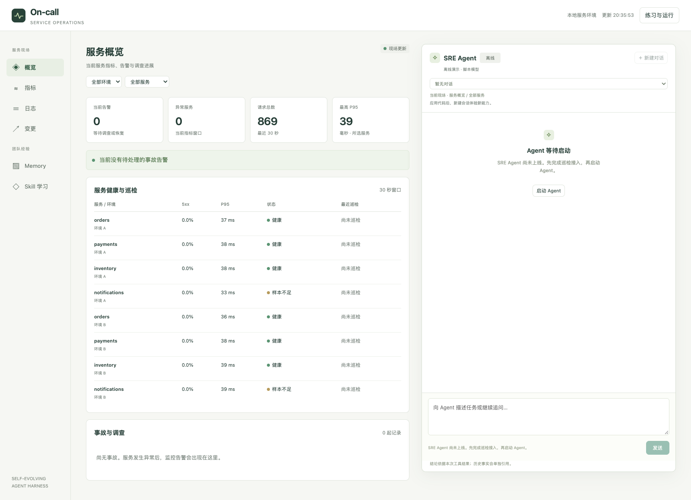

## 2. 让巡检先转起来

打开「练习与运行」，点击「启动 Agent」。参考模式已经提供完整实现，可以直接启动；侧栏里的「待检查」表示尚未运行对应检查，不代表参考函数缺失。实作模式则从同一入口接入你实现的能力。

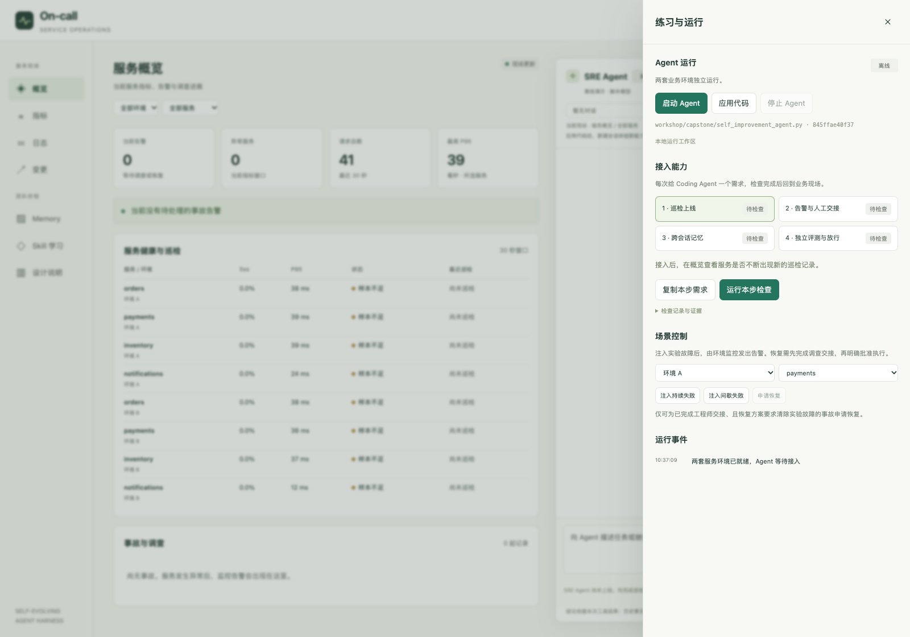

关闭侧栏，观察两套环境。正常流量和巡检请求会持续产生，服务记录会刷新。巡检由 `service-patrol` Skill 控制；每个实例保存自己的巡检记录、Session 和报告 Item，以便后续核对与恢复。

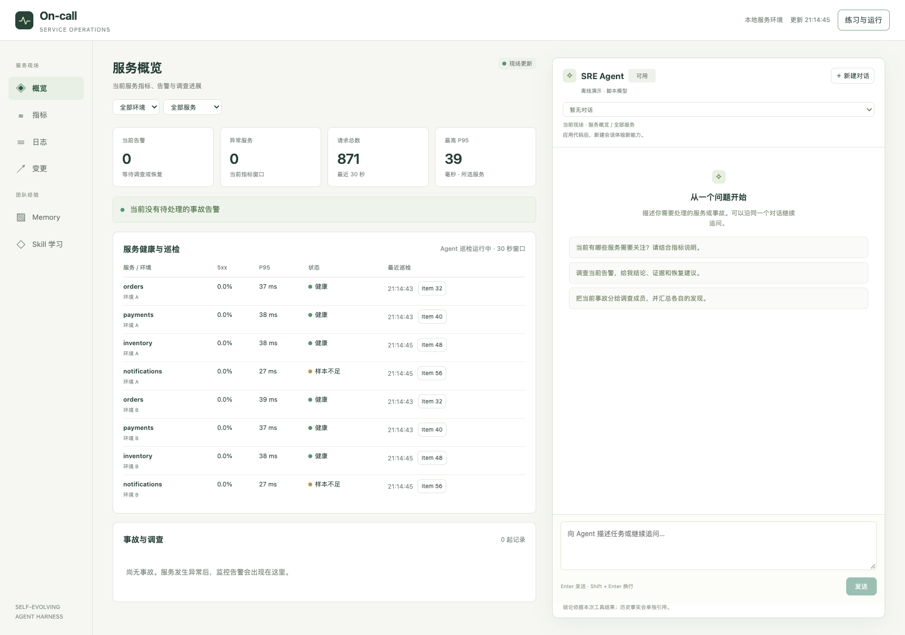

表格中的「最近巡检」来自 Agent 已保存的检查点，显示检查时间和报告 Item。点击 Item，可以回到对应 Session，核对读取的 `service-patrol`、工具参数及原始回执。等下一轮结束，再看时间与 Item 是否推进；业务请求数增长本身不能证明 Agent 在巡检。

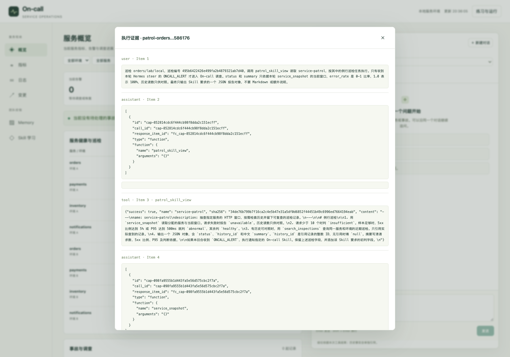

此时先做一个判断：当前证据足以说明所有服务都正常吗？对照窗口和请求量，保留样本不足的判断。

## 3. 注入故障，观察告警如何进入任务

在「练习与运行」中，给环境 A 的 `payments` 注入持续失败，给环境 B 的 `orders` 注入间歇失败。环境监控负责发出原始告警；Harness 接收事件并 steer 当前巡检回合，Hermes 按 `oncall-alert-triage` Skill 调查。

回到概览，待处理事故会优先显示在服务表上方。先看事故的服务与环境，再对照下方指标和最近巡检记录。初判之后，系统从报告 Item fork 补查，形成调查结论和恢复建议，交接给值班工程师。交接完成后，原进程继续巡检。

两端都完成交接后，截图聚焦环境 A 的 `payments`。展开事故卡片，可以看到告警、调查、工程师交接的进度，以及补查探测与恢复建议。此时右侧还没有附加对话，避免将自动处置主链和后续人工提问混在一起。

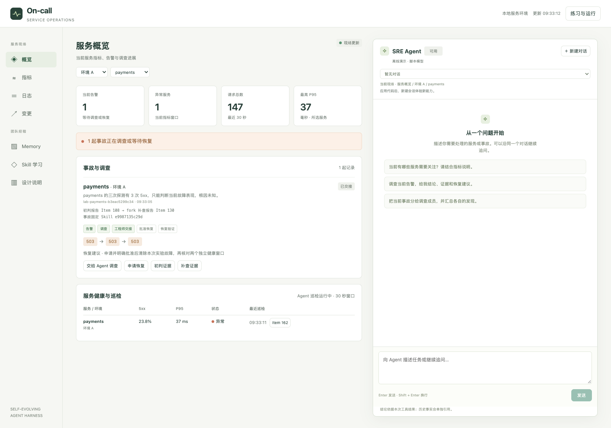

## 4. 用现场证据检验结论

保留环境 A、`payments` 的筛选，切到「日志」，选择「失败请求」，核对环境、服务、HTTP 状态与时间。持续失败和间歇失败能否只凭一次请求区分？再切到「指标」「变更」对照观察。探测到 5xx 可以说明故障表现，仍不能直接当成根因。

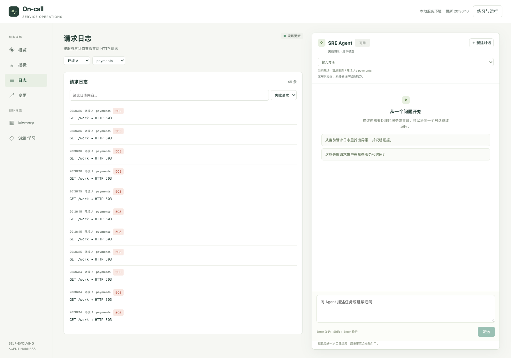

回到概览，将环境和服务筛选恢复为「全部」，新建对话，在右侧问：

> 调查当前告警，给我结论、证据和恢复建议。

工作台会展示调查成员和各自返回的结果。打开调查证据，可以回到实际工具调用。持续巡检主链已经完成的初判、补查与交接，和对话中的附加复核，分别留下记录。

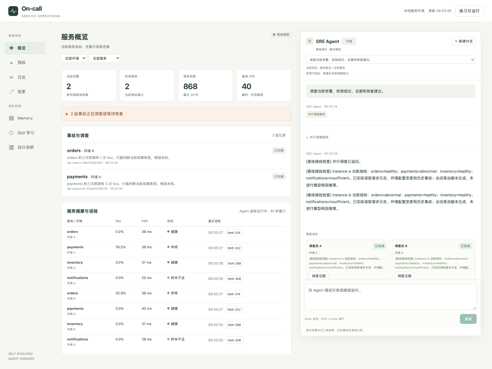

读完结果，再问自己：哪些结论来自本次取数，哪些仍待确认？截图中的脚本响应明确保留了其推理限制；接入真实模型后，也要用同样的证据要求检查回答。

## 5. 核对范围，再批准恢复

筛选环境 B 的 `orders`，在已交接事故上点击「申请恢复」。逐项读恢复弹窗：事故 ID、环境、服务、源调查和恢复动作。这里批准的是清除本地实验故障，范围绑定到这一份申请。

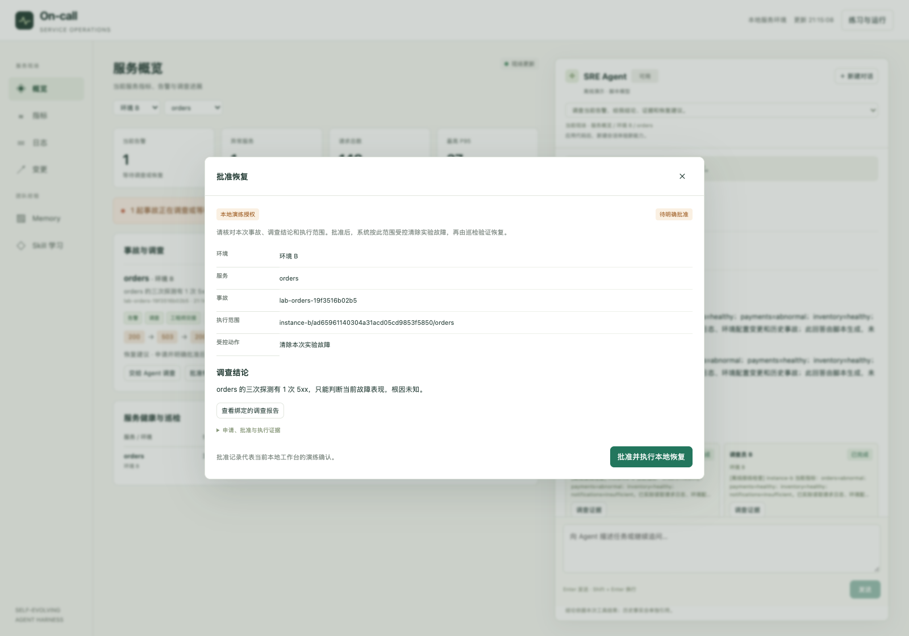

确认后点击「批准并执行本地恢复」。不要立即把事故当成已经恢复：动作执行之后，系统仍要等待两个互不重叠的健康窗口。弹窗会显示已取得的窗口数、起止时间、请求数与报告 Item。下图是 1 / 2 的中间状态，事故仍未关闭；窗口进度来自持久化巡检回执，不是按等待时间估算。

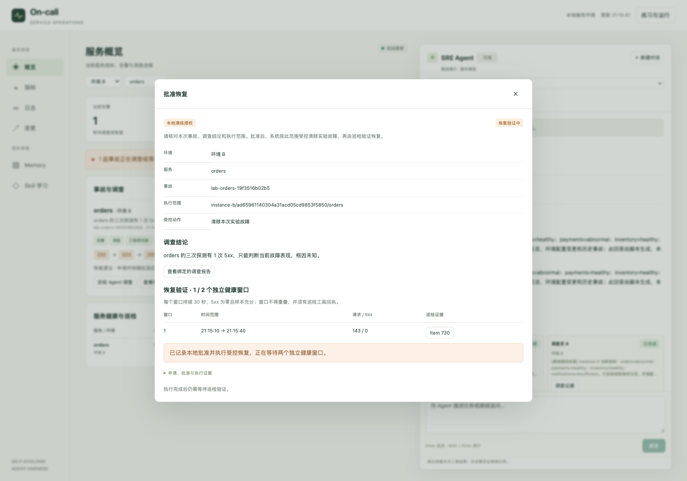

分别完成两端的审批与验证。回到概览，确认事故恢复记录已经形成，并且巡检继续推进。一次请求成功不足以替代两个独立窗口。

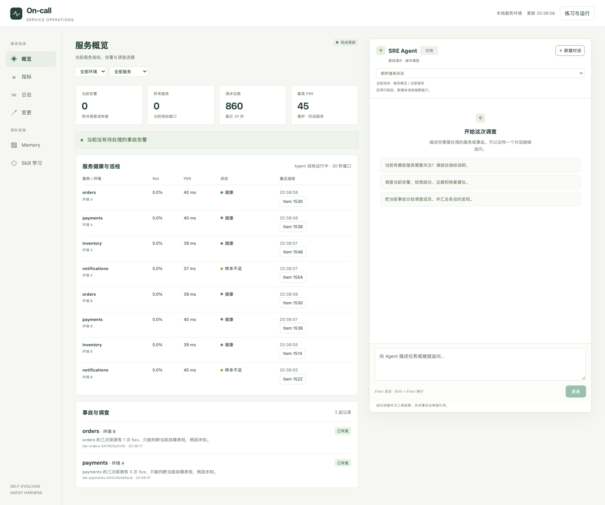

## 6. 把事实留下，让新任务重新核对

新建一段对话，清空上一轮调查的显示；进入「Memory」，点击「复盘已恢复事故」。查看保存的历史事实及其来源，再点击「新会话召回」。新任务应检索旧事故，并重新获取当前现场；同一段对话还能记得刚才发生的事，不足以证明跨会话记忆。

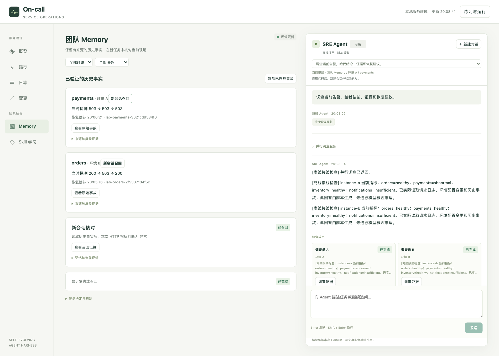

本次召回发生在第一轮恢复后、第二轮故障注入前。截图中的历史事实有明确事故来源，新会话也重新查询了当前 HTTP 指标，得到健康状态。随后再注入故障，就应重新取数，不能沿用这里的健康结论。

历史记录回答“当时发生过什么”。当前取数回答“现在是什么状态”。如果没有形成可保存的新事实，复盘也可以保留原状；以页面记录的实际决定为准。

### 入口变化后，原有记忆怎样失效与修订

仍在「Memory」页，切到「入口与 Memory 修订」。这次使用环境 A 的支付诊断入口；每个按钮只推进一步，不会替你连跑后面的阶段。该环境和持续巡检进程保持运行。

先点击「读取旧记忆」。演练准备了指向 `/diagnostics/v1` 的原生 Memory，独立 Hermes 会话实际读取这份记忆，并取得 HTTP 200。核对旧入口、Memory 内容哈希和本步 Session。

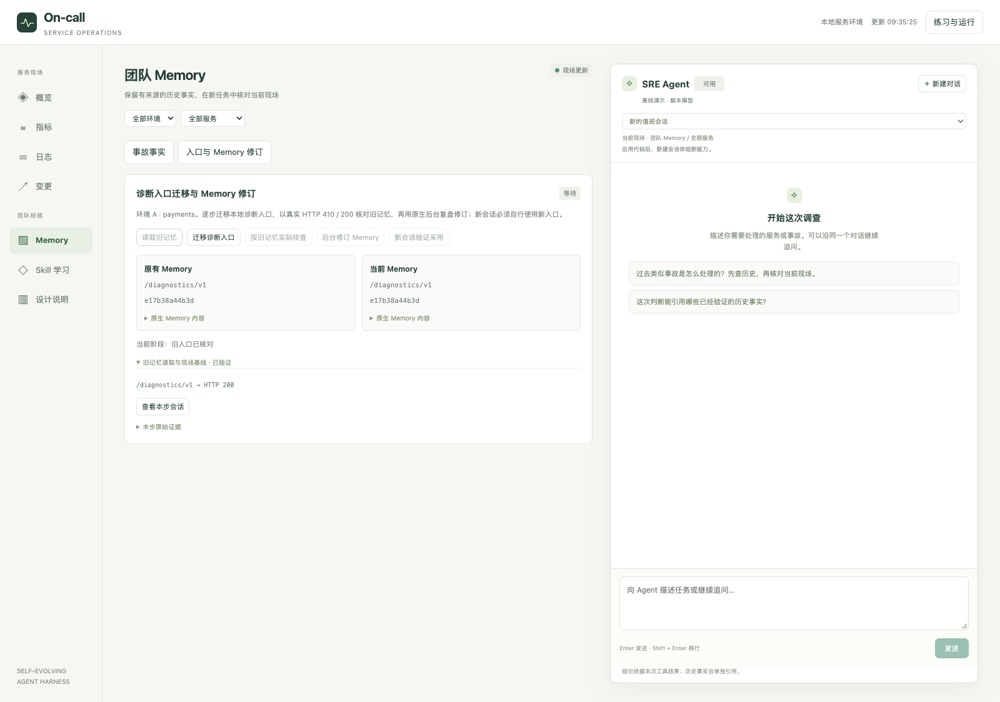

点击「迁移诊断入口」。环境将旧入口退役，新入口变为 `/diagnostics/v2`；此时 Memory 仍然指向 v1。页面上的 410 和 200 是环境切换回执，不能把它们当成 Agent 已经修订了记忆。

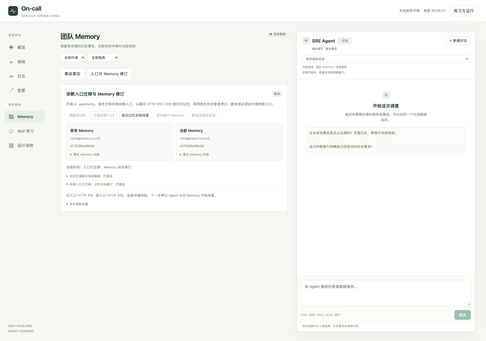

点击「按旧记忆实际排查」。新 Session 从旧 Memory 开始，先请求 v1 得到 410，再沿返回信息请求 v2 得到 200。现在才有可用于修订的实际排查证据。

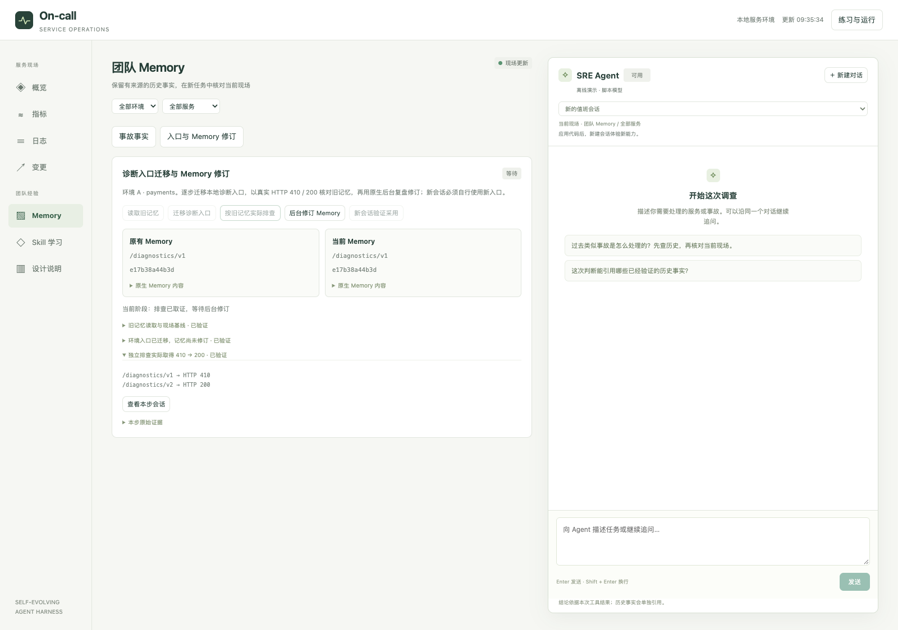

点击「后台修订 Memory」。原生 Background Review 根据刚才的排查记录执行 `memory replace`，页面对照原有与当前 Memory 的入口和内容哈希。后台复盘回执与普通持久化 Session 分开记录，不能把一个“已完成”的文字提示当成写入证明。

最后点击「新会话验证采用」。新 Session 只获得服务与环境，再从修订后的 Memory 找入口；它的首次诊断请求应直接访问 v2，得到 200。对照「查看本步会话」，确认新 Session、实际加载的 Memory 哈希与第一次工具调用。旧 Memory 文件仍然保留，便于解释前后差异。

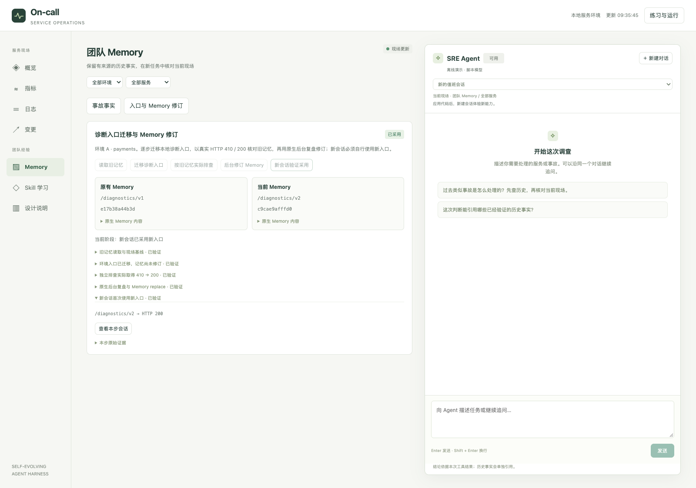

## 7. 经评测批准，方法才进入正式版本

保持右侧为新对话，进入「Skill 学习」。两端已经恢复并归档的初判会话进入同一演化批次，SkillClaw 生成隔离候选。持续失败、间歇失败、首次成功未复现这三个冻结现场，分别让新旧 Skill 从独立会话开始成对回放。

本轮还保留「候选修订的工程分析」：教学工程分析模板先核对两个真实补查分支的来源和回执，再提供有界追加探测的改进方向。原始初判仍是 SkillClaw 的会话来源，补查分支不会冒充第三、第四份训练会话。点击两端「补查依据」，再核对实际候选修订请求的分析哈希，确认整理后的工程分析确实进入模型输入。脚本模式使用预设工程策略和确定性模型响应，不能据此宣称模型自主发现了这条规则。

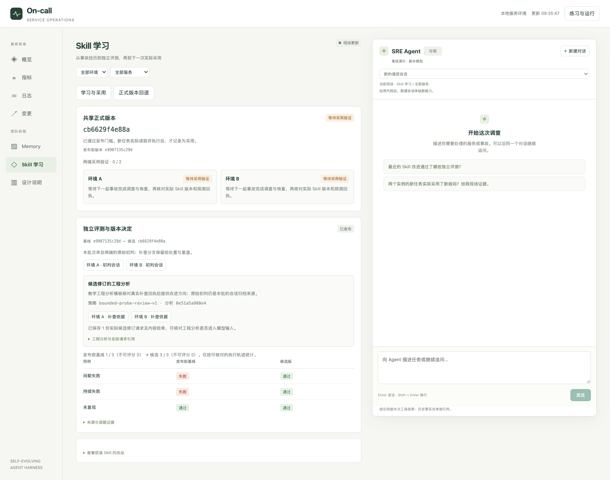

先读逐题结果，再看发布决定和版本 hash。评测表明确标出“发布前基线”和“候选版”，避免发布后把历史基线误认成当前正式版。

“共享正式版本”展示已经获准的内容；下方两张采用卡片分别对应环境 A、B。刚发布时是 0 / 2，等待下一起事故的执行证据，不能提前说两个实例已经用上新版。评分缺失、候选回归或改进证据不足时，应保留现行版；运行异常也会留下原因。

## 8. 再来一次事故，证明新版真的被用到

发布后交换故障类型：A 改成间歇失败，B 改成持续失败。等待下一轮调查，按相同流程批准恢复，并等两个健康窗口通过，再回到「Skill 学习」看两端采用记录。当前实现只在事故恢复并形成完整记录后确认采用；刚收到交接时仍可能显示「等待采用验证」。应核对实际读取的 Skill hash 和现场探测回执，不能仅凭文件已经同步就宣布采用成功。两端采用验证达到 2 / 2 后，分别点击「查看采用证据」，回到各自的原生 Session 核对执行过程。

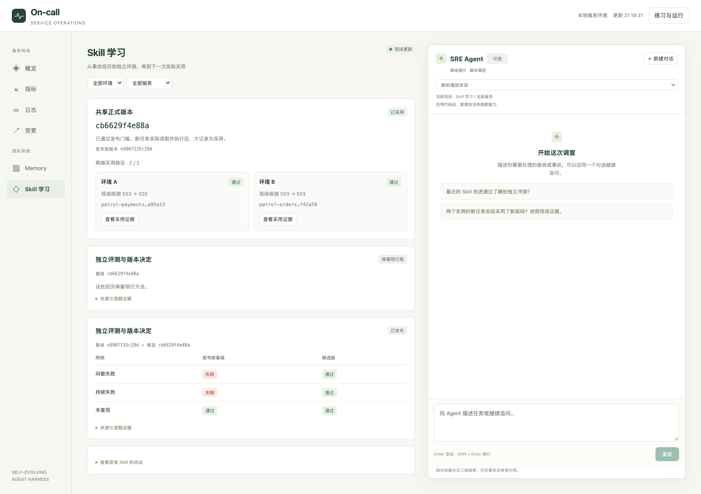

若后续批次显示「保留现行版」，先查看决定来源。已有方法不必每批都改，后台可以保留正式版并继续运行。

## 9. 明确批准回退，再验证两端实际恢复

在「Skill 学习」切到「正式版本回退」。先完成上面的两端采用，再点击「准备回退方案」。准备只记录方案，不发布任何内容。核对当前批准版本、上一批准版本、两端服务范围和当前运行，再决定是否点击「批准回退并验证」。这是本地演练确认，不代表已经接入企业身份认证。

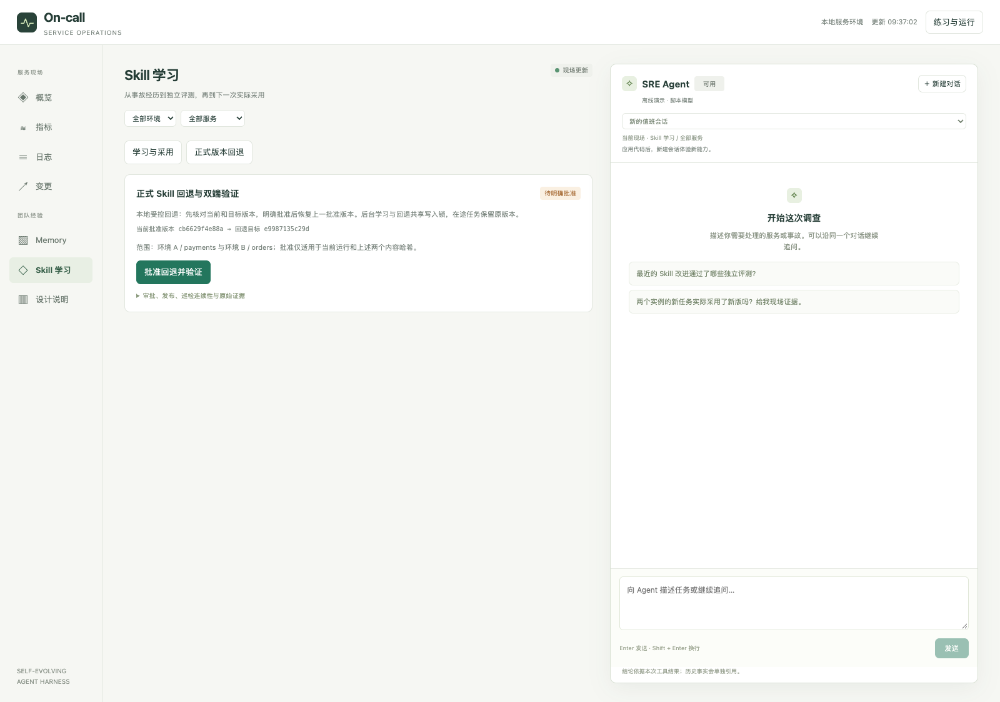

批准后，正式内容经原生 SkillHub 发布到两端。两个新 Hermes Session 分别读取恢复版 Skill、查询当前 HTTP 指标并进行有界探测，页面保留它们的版本哈希、工具回执和报告 Item。同时核对原巡检检查点继续推进。

后台 learner 与人工回退共享发布锁，并在每个学习周期重新读取权威状态。回退验证尚未完成时，不生成下一次发布决定，避免后台用旧的内存状态覆盖刚批准的版本。部分失败会保留待验证状态与原审批，使用「继续验证已批准的回退」重试。

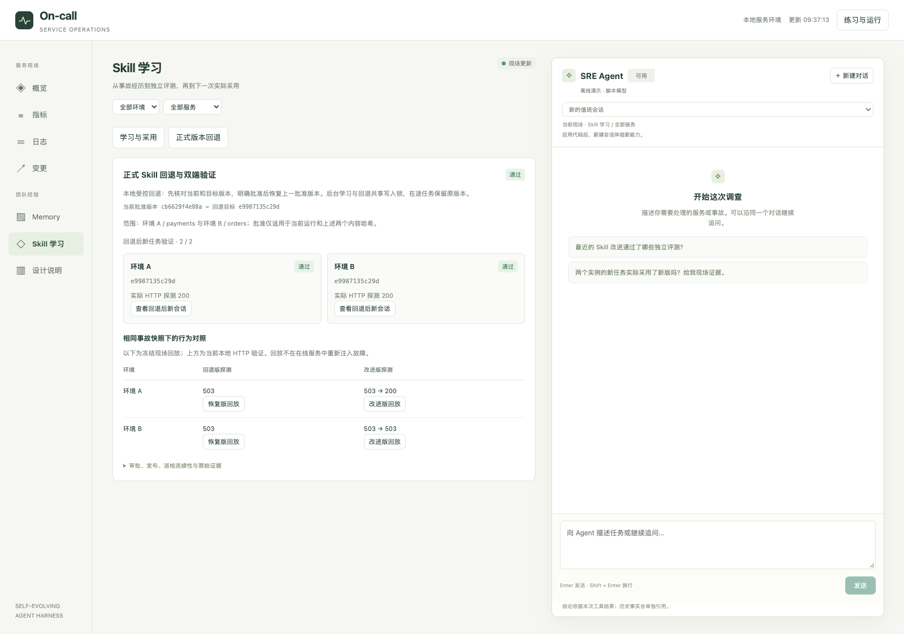

当前现场已经恢复健康，单次 200 不足以说明旧方法和改进版的行为差异。因此，系统另取第二轮事故的同一份冻结快照，分别运行恢复版与改进版。恢复版在首次 503 后停止，改进版继续取得第二次回执。两种结果来自各自全新的原生 Session，页面明确标为冻结回放，不在在线环境重新注入故障。

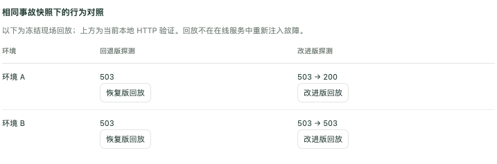

点击「恢复版回放」或「改进版回放」，核对本次读取的 Skill、冻结数据来源、工具请求和对应报告 Item。当前 HTTP 核验与冻结行为对照共同说明：文件已恢复，接收端已经同步，新任务也确实按相应版本执行。

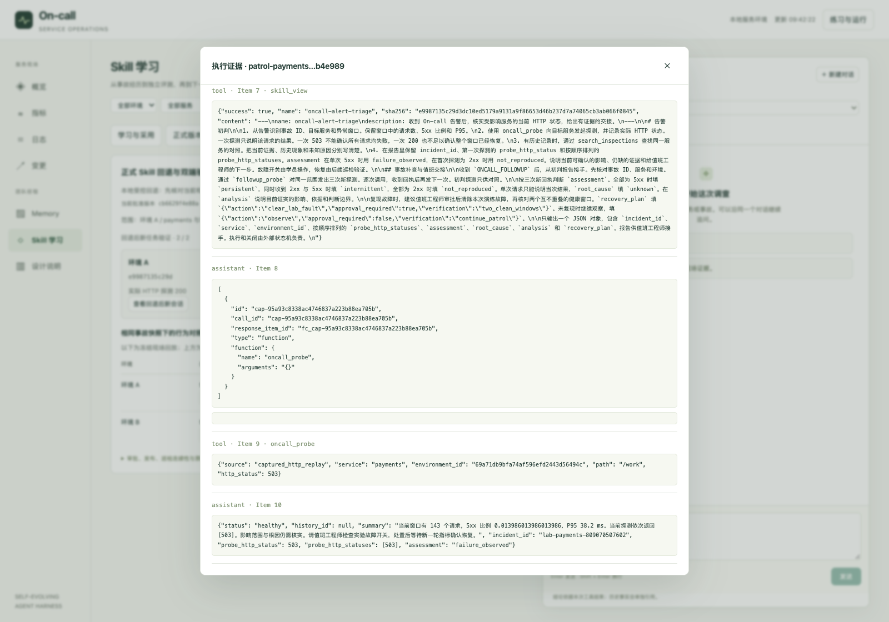

### 回退执行过了，最终提交中断怎么办

下面两张图展示独立的中断恢复演练，使用本地脚本模型。在两端验证和冻结回放完成后、最终权威状态提交前，向回退工作进程注入一次 SIGINT，检查执行证据和审批记录如何接续。

中断后，两端执行证据已经保存，但页面仍显示「待完成验证」，并保留「继续验证已批准的回退」。子任务通过不能替代整个回退完成；后台学习此时继续等待，原巡检仍然运行。

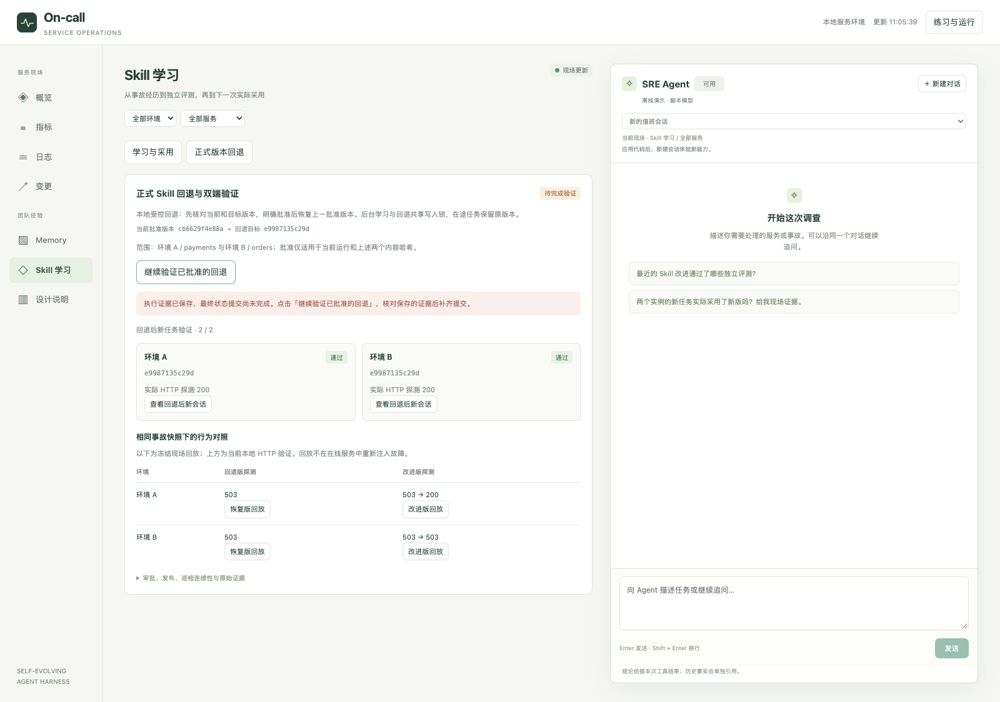

点击继续验证，系统核对已固定的完成证据、当前版本和接收端文件，再补齐最终提交。下图恢复为「通过」；本次重试保留原审批、原验证 Session 和原回放结果。运行记录也确认没有重新发布或重跑模型任务。这一结论仅适用于完成证据已经可信保存的中断点；较早失败的任务仍需执行尚未完成的验证。

## 10. 进入生产前，还需要覆盖哪些设计要求

打开「设计说明」。第一块卡片回读本次 Memory 与回退证据；后面的卡片分别说明生产治理和分布式系统设计题。它们明确标注为设计，不能据此宣称本地工作台已经具有企业级灰度或跨机器调度能力。

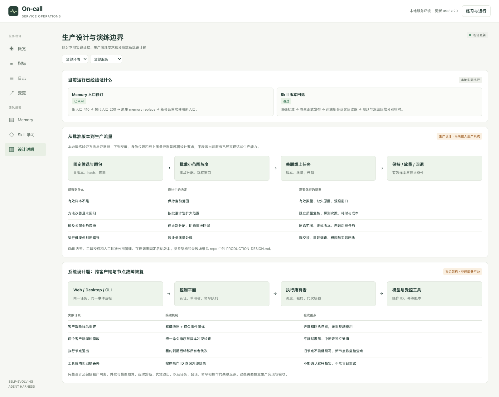

生产发布还要固定范围、有效样本和停止条件，关联任务实际使用的版本，同时观察运行健康、业务质量、工具开销与模型成本。样本不足时保持范围，触及底线时停止分配并回退；Skill 内容不能自行扩大生产权限。

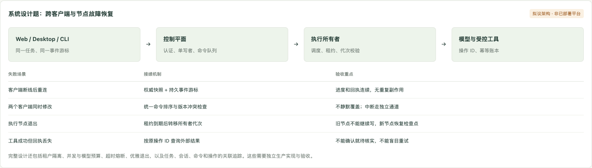

Web、Desktop 和 CLI 继续同一任务时，应共享权威状态和事件游标；普通命令经过单写者协调，中断使用独立通道。节点失败后按租约和所有者代次接续，具有副作用的操作先查账本和外部实际结果，不能凭恢复后的聊天上下文盲目重试。完整方案、失败场景和验收条件见[生产扩展设计与系统设计练习](PRODUCTION-DESIGN.md)。

到这里，你观察过一条完整的链：服务持续运行，巡检积累记录，外部告警进入当前任务，调查交接后继续巡检，恢复经过明确批准和验证；事故事实进入共享记忆，入口变化推动原生 Memory 修订；初判经历与有来源的工程分析推动候选修订，独立评测决定发布，新任务验证采用；正式版本也能经过明确批准回退，再由两端新任务和同现场行为对照核实。

接下来按[四步实作](lab/README.md)自己搭建这条链。每次给 Coding Agent 一个当前目标，运行检查，再回现场验证行为。完整两轮验收命令和逐项证据位置见[综合实战 README](README.md#运行双实例演练)。
